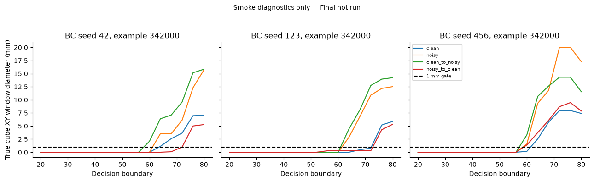
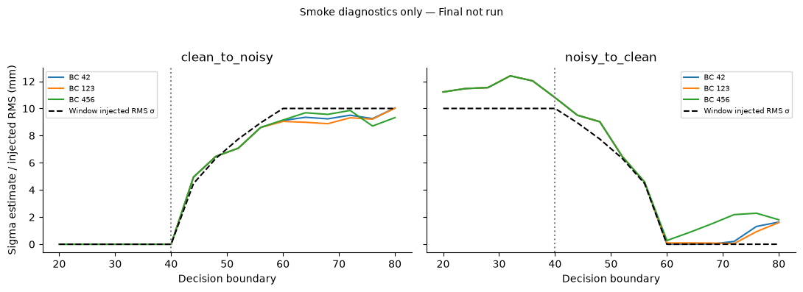
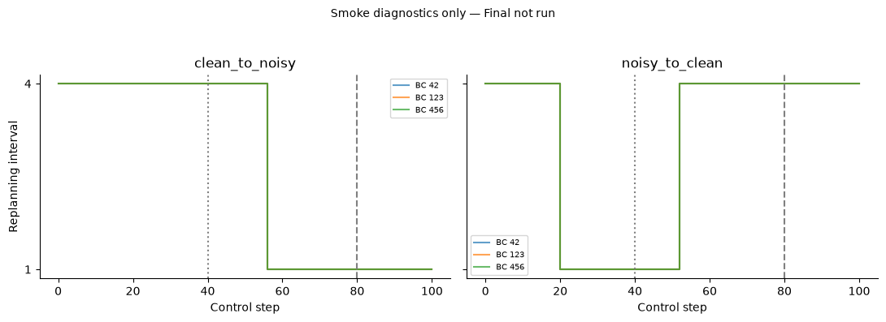
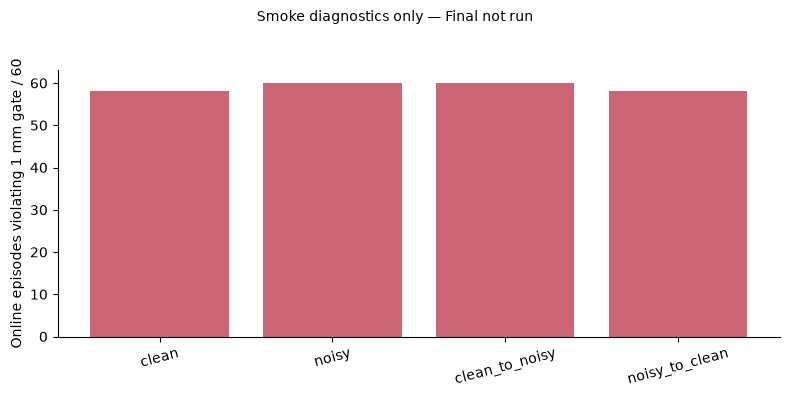
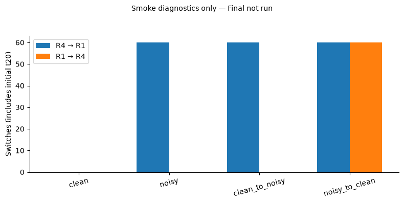
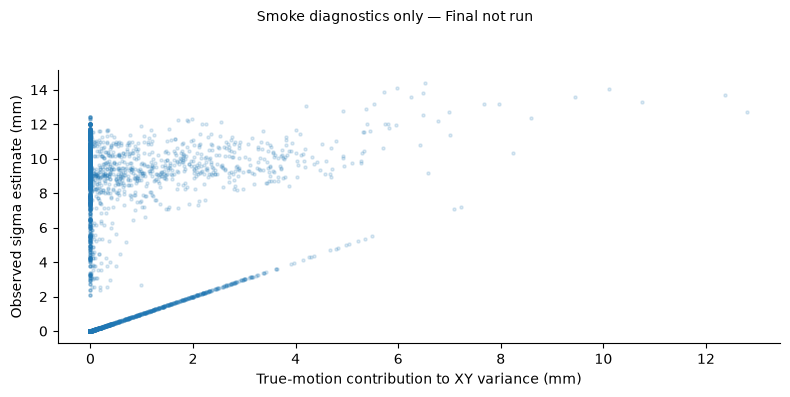

# Online Uncertainty-Aware Replanning under Dynamic Observation Noise

**Status: Stopped after complete smoke evaluation because the preregistered stationarity gate failed.** All 48 smoke cells / 960 episodes are complete and preserved. Calibration: **0/14,400**. Final: **0/48,000**. No Final success rates, primary effect, confidence intervals, beneficial/harmful outcome counts, or significance claims are available. The planned experiment is not complete.

## 1. Abstract

We implemented a phase-limited, observation-only online replanning controller for three frozen H4 behavior-cloning policies. A 20-observation rolling XY variance estimate selected one-step or four-step execution at four-step boundaries from control steps 20–80, using fixed 6.5/8.5 mm hysteresis around the previous 7.5 mm initial threshold. Four observation-noise profiles included constant clean/noisy and both directions of a step-40 transition. All 960 preregistered smoke episodes passed software integrity, pairing, and legacy equivalence checks. However, 236 of 240 Online episodes violated the 1 mm true-XY-motion criterion in at least one estimation window; maximum window diameter was 45.05 mm. The study therefore stopped before Calibration and Final. Bidirectional switching worked mechanically, but valid noise detection and improved grasp reliability were not established.

## 2. Background and Motivation

The previous completed one-shot study achieved 90.54% mean success against 88.48% for R1 and 89.53% for R4 under constant synthetic observation noise. It made one decision after a 20-step R4 warm-up. This new study asks whether later updates help when observation quality changes. Previous results are background, not outcomes of the present study.

## 3. Research Questions and Hypotheses

The preregistered questions concern detecting changes, improving Online versus OneShot under both dynamic profiles, recovering R4 after noise decreases, and model-dependent harmful transitions/cost. Competing hypotheses permit benefits, null effects, and harm. None was tested on Final because the prerequisite gate failed.

## 4. Related Work

ACT and Diffusion Policy motivate sequence prediction and action-chunk execution. ResiP and ResFiT concern residual or off-policy reinforcement-learning refinement of behavior-cloned policies; this experiment performs no training. PACE and RAIN are prior related work on adaptive action-chunk execution/refinement as discussed in the preceding report. This study claims neither invention of adaptive replanning nor equivalence to those systems. It evaluates a specified rolling-variance heuristic on a state-conditioned H4 MLP. No real camera occlusion, learned perceptual uncertainty, or fully continuous adaptation was tested. Bibliographic verification or new literature claims were outside this stopped evaluation; references and prior positioning remain in the preceding study report.

## 5. Frozen Policies and Data Provenance

Base commit: `f83df879d58b40efef82b2b4b649e5f1ed04c77a`. Branch: `experiment/h4-dynamic-uncertainty-replanning`.

| BC seed | Checkpoint SHA-256 |
|---|---|
| 42 | `41cda0af609e3064ba8e485a4ef81289c319472b08d1f710d96b30f6cb470557` |
| 123 | `5dc02a9b9cce85b93beb18288c0681c90e5174181210cd4c0c23d518d653495c` |
| 456 | `649e42de42f0a04a2dc180dfa513afbbc52aba2e78f4f6c28a3deb41eb3cd706` |

Paths are `bc_models/action_chunking/H4_seed{42,123,456}.pt`. Hashes match the completed Adaptive protocol and are rechecked by evaluation/audit. Horizon 4, 12-dimensional normalization, action scaling 0.15 m, control timestep 0.1 s, max time 16 s, gripper convention, physics, and success criterion were preserved. No BC/SAC training, weight modification, portfolio edits or historical data edits occurred. Python 3.12.10, NumPy 2.5.4, PyTorch 2.15.0, MuJoCo 3.17.0 and Gymnasium 1.4.0 were reused on the Mac Studio M1 Max. Menagerie commit is `98a70c569c4c1b6da467a20012f766ee1f8dc521`.

## 6. Dynamic Observation Noise

The four profiles are clean (0→0 mm), noisy (10→10 mm), clean_to_noisy (0→10 mm), and noisy_to_clean (10→0 mm). The transition starts at absolute observation index 40. A common float32 standard-normal schedule of shape (161,2) is generated by the legacy SeedSequence([20261106,evaluation_seed]) convention. Profile sigma multiplies that schedule at each absolute step. Only observed cube XY and matching relative XY are perturbed. Neither true physics nor the policy's other observation components change. Controllers have no profile, true sigma or transition-time input.

## 7. Online Uncertainty Estimation

The primary estimator remains sqrt((sample_var(x,ddof=1)+sample_var(y,ddof=1))/2). At decision boundary t it receives exactly samples t−20 through t−1; observation t is excluded. Ground-truth window diameters and injected RMS sigma are evaluator-only diagnostics. True XY movement contaminates this statistic even when injected sensor noise is zero.

## 8. Controller Design

R1 uses action 0 of a new H4 prediction every step. R4 consumes indices 0–3. OneShot uses the legacy 20-step R4 warm-up and the inclusive 7.5 mm R4 threshold once. Online shares the first decision, then updates at t=24,28,…,80. It switches R4→R1 strictly above 8.5 mm and R1→R4 strictly below 6.5 mm. A decision consumes the completed old chunk and creates a fresh prediction from observation t, starting index 0. This explicitly avoids carrying action 1 of an old R1 prediction into a new R4 block. No inference/decision occurs after termination. After t80, interval selection freezes.

## 9. Preregistration

Protocol commit: `481292c`. SHA-256: `bd1a33cba0299b40402ce4f4af4d4f9e552fd391b5306f60c9ea4166ceb6c21e`. Protocol and hash were committed before new rollouts; thresholds and specification were not changed afterward. The 1 mm threshold is the previous study's tolerance, applied here to maximum pairwise true cube XY displacement in each actual estimator window. Any violation in an Online decision window or OneShot initial window prevents progression. Ground-truth XYZ motion is separately recorded. All fixed-policy windows are also diagnosed.

## 10. Software Validation

All 44 unit tests passed, including 11 new tests for exact windows, hysteresis boundaries, R1↔R4 prediction timing, terminal behavior, step-40 noise generation, deterministic schedules, initial prefix equality, resumable row validation and failed-gate refusal. All source files passed syntax checks. Smoke integrity verified 48 complete cells and 960 ordered, unique expected seeds, model/protocol metadata, absolute-step noise hashes, true initial positions, trace window reconstruction and action-index timing.

Constant-profile R1/R4/OneShot matched legacy outcomes/counters at predetermined seeds 342000–342001 for all three models (36 checks). Three repeated Online clean_to_noisy rollouts at seed 342000 reproduced every non-timing field exactly. All 240 R4/OneShot/Online first-20-step prefixes matched within each model/profile/position. Evidence: `legacy_equivalence_audit.json` and `smoke_integrity_audit.json`.

## 11. Calibration and Stationarity Audit

**Calibration was not started because smoke already failed the prerequisite stationarity gate.** This follows the stronger preregistered gate and avoids spending 14,400 additional rollouts after the same estimator assumption was falsified.

| Online profile | Affected episodes / 60 | Violating windows / 960 | Maximum true XY diameter (mm) |
|---|---:|---:|---:|
| Clean | 58 | 285 | 27.92 |
| Noisy | 60 | 310 | 45.05 |
| Clean → Noisy | 60 | 345 | 33.08 |
| Noisy → Clean | 58 | 266 | 27.37 |

In total, 1,206 of 3,840 Online windows violated the 1 mm criterion, affecting 236/240 episodes. Earliest violation was the t40 window (observations20–39), before any post-transition sample is included. At 0 mm, post-change-only windows had mean absolute estimated-sigma error 1.03 mm; this clean condition directly exposes movement contamination. Mixed-window mean absolute errors versus injected RMS sigma were 0.93 mm for clean→noisy and 1.01 mm for noisy→clean. Post-change-only errors were 0.88 and 1.02 mm, respectively. These are smoke diagnostics, not validated uncertainty accuracy or independent-window inference.





## 12. Final Evaluation Protocol

Planned Final seeds are 341000–341999: 3 models ×4 profiles ×4 controllers ×1,000 =48,000 episodes. None were run or inspected. Planned Calibration seeds340000–340299 also remain unused. Smoke used342000–342019. The evaluator enforces predecessor audits, append-safe/fsync row writing, one global writer lock, metadata/hash checks, complete-prefix validation and November14,2026 cutoff. No Final sample size was reduced, no estimator was replaced, and no timing boundary or threshold was tuned.

## 13. Success Rate Results

Unavailable. This stopped smoke study does not report new controller success rates. Smoke success labels remain in raw CSVs for integrity/equivalence purposes; no aggregate performance ranking is presented.

## 14. Online versus One-Shot Analysis

The primary effect was planned as equal-weight Online−OneShot success over the six model×dynamic-profile cells, excluding constant profiles. No Final effect, confidence interval, seed-level effect, or significance test was computed. Mechanical switching cannot substitute for this primary endpoint.

## 15. Beneficial and Harmful Transitions

Unavailable as confirmatory outcomes. The planned analysis would report baseline-failure/Online-success, baseline-success/Online-failure, both-success and both-failure and verify their arithmetic. No causal attribution to a particular switch is possible from the current diagnostic traces. Smoke outcomes were not used to select a controller.

## 16. Switching Behavior and Detection Delay

Smoke Online performed 60 R4→R1 switches under constant noisy, 60 under clean→noisy, and 60 initial R4→R1 plus60 R1→R4 switches under noisy→clean. Constant clean had no switches. Both directions are implemented successfully.

All60 dynamic examples per profile made an appropriate post-change switch under nominal-noise diagnostic labels. Clean→noisy first-switch delay median18 steps (range8–24; 1.8 s median simulated time). Noisy→clean median12 steps (range8–20;1.2 s). No post-initial switches disagreed with the nominal noise label. These counts do not validate the estimator: stationarity failed, windows overlap, and observations/positions are shared across models. Meaningful reliability evidence requires a valid estimator assumption and held-out Final evaluation.







## 17. Computation and Inference Cost

Smoke Online mean model calls per episode were30.73(clean),105.08(noisy),76.90(clean→noisy),55.07(noisy→clean). These counts are diagnostic only; they are not a Final compute-success trade-off. Per-episode calls, inference latency/time, wall time, interval exposures and decision counts are retained in raw CSVs. Timing is descriptive under uncontrolled machine load and excludes environment construction/reset. No speedup or robot-execution advantage is claimed.

## 18. Statistical Analysis

Preregistered:10,000 paired position-bootstrap resamples sharing indices across profiles/controllers/models; exact model/profile McNemar tests; Holm correction in specified families. Training-seed effects would have been summarized by mean, median, sample SD, range and direction consistency. These analyses were not run. The960 smoke episodes and overlapping windows are not independent policy-training replications. There are only three fixed trained policies.

## 19. Failure Analysis

The implementation passed its checks; the estimator's assumed stationary phase did not. True object motion occurs before the expected end of the t20–80 adaptation phase, including t40 windows. A variance statistic cannot generally separate that motion from sensor noise. Noisy→clean switches demonstrate controller functionality, not identification of the noise process. The prescribed stop condition prevents claiming that accurate switching improves grasp success without valid measurements.



## 20. Limitations

This is an incomplete experiment stopped for a scientific validity reason, not a completed48,000-episode evaluation. No Calibration or Final effects exist. Synthetic state noise does not model camera occlusion or realistic temporal correlation. The rule is phase-limited, with fixed thresholds and three policies. The1 mm criterion is deliberately conservative; failing it establishes violation of the preregistered premise, not the numerical size of every control bias. Six generated SVG/PNG figures are **diagnostic replacements**, not the requested Final success/improvement/benefit/cost-performance figures, which cannot be supplied honestly without Final data.

## 21. Implications for Reliable Robotic Manipulation

The useful finding is that extending an initial stationary-window estimator into execution requires an independent motion audit. Correct code, responsive switches and nominal noise-label agreement are insufficient to establish reliable control. The prior one-shot constant-noise study remains unchanged.

An 80–100-word Statement of Purpose paragraph, limited to completed work:

> I investigated when uncertainty estimates can safely guide action-chunk execution in robotic manipulation. After a frozen-policy study, I implemented bidirectional online replanning and preregistered its evaluation under changing observation noise. Although all 960 software-validation rollouts passed integrity checks, a ground-truth audit revealed that object motion contaminated the rolling variance estimator. I stopped before confirmatory evaluation rather than report misleading robustness gains. This experience sharpened my interest in uncertainty estimation that separates sensing errors from task dynamics, and in experimental safeguards that make robotic reliability claims reproducible and scientifically defensible.

## 22. Next Research Direction

The next question is whether an observable, motion-aware uncertainty estimator can distinguish sensor error from object dynamics without hidden-state access. Answering it requires a separately authorized, preregistered study and new held-out evaluation; no new estimator, thresholds, profiles, BC/SAC training or extended decision phase was added here.

## 23. Reproduction Instructions

Use the same3 checkpoint files and verify their hashes; reuse the previous environment requirements and Menagerie commit above. Existing complete smoke data must not be removed or overwritten. The following evaluator invocation validates/skips the completed48 cells:

```sh
MPLCONFIGDIR=/private/tmp/matplotlib-h4 .venv/bin/python evaluate_h4_dynamic_replanning.py --phase smoke
MPLCONFIGDIR=/private/tmp/matplotlib-h4 .venv/bin/python -m unittest discover -v
```

`validate_h4_dynamic_legacy.py` produces the saved equivalence audit. `audit_h4_dynamic_replanning.py --phase smoke` produces a failed gate and exits2. `analyze_h4_dynamic_replanning.py --phase smoke` produces diagnostics and 6 SVG/PNG figures. `diagnose_h4_dynamic_switches.py` recreates the nominal-noise switch diagnostics. Audit/diagnostic tools refuse to overwrite existing evidence: run them in a separate reproduction checkout with archived outputs. Calibration/Final evaluation is intentionally refused by the saved failed gate; do not bypass it or modify the protocol to proceed. No study lock or partial files remain after completion. All historical source/data remain intact at the base commit.
