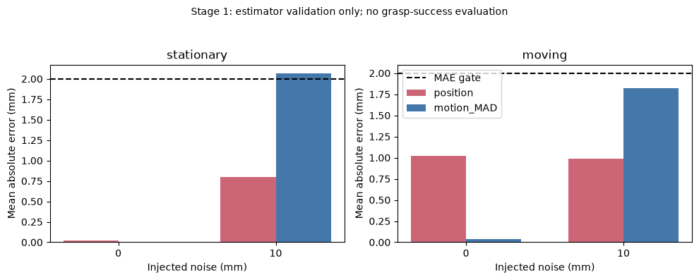
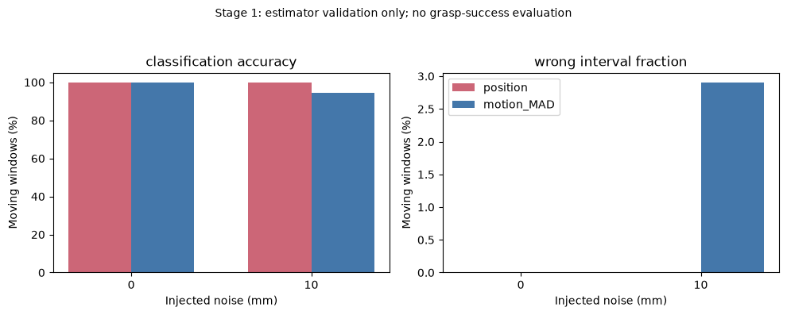
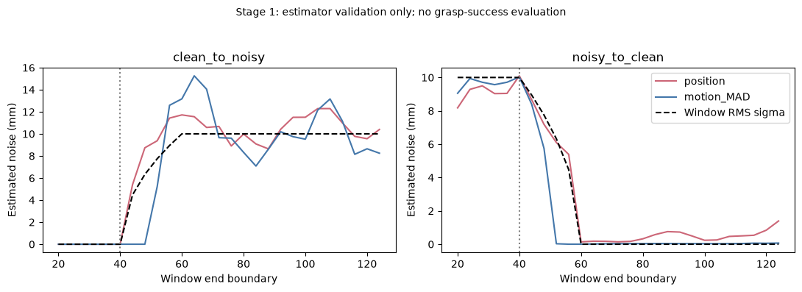
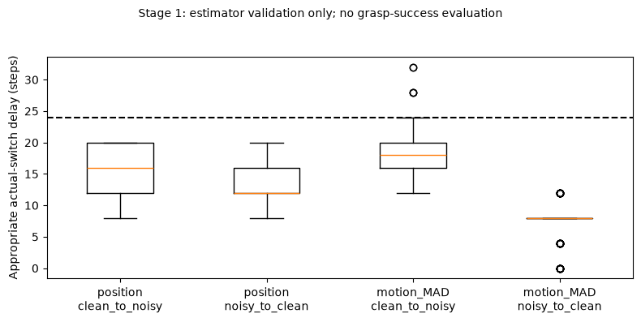
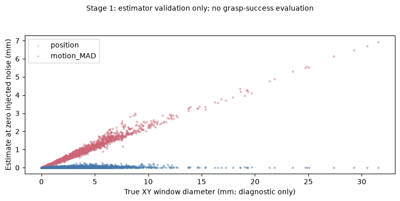
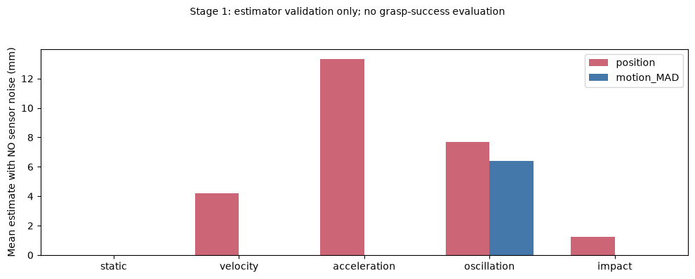

# Stage 1: Motion-Aware Observation-Noise Estimation for Frozen H4 Policies

**Stage 1 completed; validity gate FAILED. Stage 2 will not proceed.** This is an estimator-validation study, not a new grasp-success experiment. The stopped dynamic-replanning experiment remains stopped and unchanged.

## 1. Abstract

We compared a 20-sample position-variance estimator with a second-difference median-absolute-deviation (MAD) estimator on independent diagnostic observations derived from real MuJoCo cube motion. Three frozen H4 policies, executed under fixed R1/R4 control on 20 new reset positions, generated 120 actual physical trajectories. Four paired observation-noise replays produced 480 diagnostic sequences. The MAD estimator substantially reduced motion contamination at zero sensor noise but failed the prespecified gate: moving-window 10 mm classification accuracy was 94.61% (required ≥95%), stationary 10 mm MAE was 2.07 mm (required ≤2 mm), and pooled moving-window MAE reduction was only 7.21% (required ≥25%). Mixed-noise transition windows and time-varying acceleration remained problematic. No estimator was retuned, no training or new Final grasp-success evaluation occurred, and Stage 2 was not initiated.

## 2. Scope, Preregistration and Provenance

Branch: `experiment/h4-motion-aware-noise-estimation`; base: `981e928a40c7eb3b645cde282e1d72f790f6d9f2`. Protocol commit `9bcddbb` fixed the estimators, data, metrics and acceptance criteria before acquisition. Protocol and its SHA-256 are `bc_results/h4_motion_estimator_protocol.json` and `.sha256`. Frozen model hashes match the prior completed Adaptive study. Checkpoints, historical reports, protocols and prior Smoke/Calibration/Final outputs were not changed.

Independent reset/noise-position indices are 350000–350019, with sensor-noise generation seed 20261108. All observations are new diagnostic data. The Stage 1 estimator sees only a finite `(20,2)` noisy cube XY array. It receives no ground truth, injected sigma, seed, motion label or success label. Clean physical trajectories and noise schedules exist only in the separate data generator/evaluator. Ground truth is used after candidate estimates are computed, solely to label and diagnose windows. Success labels, returns and rewards are not recorded or aggregated.

## 3. Why Offline Replay

Actual environment rollouts use each frozen policy under fixed R1/R4 with clean observations. Both estimators then receive the identical noisy replay of the actual cube XY trajectory. This isolates estimator behavior without changing motion through a candidate controller. It is not closed-loop execution under noisy observations: contact trajectories that a noisy-policy controller might produce are not represented. Noise replays across profiles share standard-normal samples wherever absolute-step indices overlap. No estimator controls actions or changes the rollout termination rule.

The 120 trajectories comprise 3 models ×2 execution sources ×20 positions. Each trajectory is replayed under constant0/10 mm and step40 0→10 /10→0 mm noise. Windows use samples `[t−20:t]`, excluding observation t, at t20,24,… through the final complete available window. This diagnostic includes moving phases beyond t80; it neither resumes nor extends the stopped controller. Variable trajectory lengths reflect ordinary episode termination, not outcome selection.

## 4. Estimators and Assumptions

The legacy estimator is `sqrt((var(x,ddof=1)+var(y,ddof=1))/2)`.

The new candidate computes `d[t]=y[t]−2*y[t−1]+y[t−2]` independently on XY. For each axis, `s = median(abs(d−median(d))) / (0.6744897501960817 * sqrt(6))`; the output is `sqrt(mean(s_axis**2))`. The Gaussian constant and sqrt(6) follow the marginal scale of independent Gaussian measurement error after second differencing; they are not fitted to this dataset. A20-sample window provides18 differences, with strongly correlated adjacent values. No finite-sample correction was introduced.

Second differences cancel affine position motion. Centering the differences also removes perfectly constant acceleration in the ideal quadratic-motion case. Time-varying acceleration, oscillation, non-smooth contact dynamics, and nonstationary/heteroskedastic errors can still affect the robust scale. Sparse isolated impacts can be rejected by MAD, but this is not guaranteed for dense or sustained disturbances. This method is not a universal separation of sensing noise from motion.

## 5. Fixed Acceptance Criteria

All criteria are conjunctive. Coverage requires at least100 stationary and100 moving pure-noise windows at each0/10 mm level and all120 trajectories/480 sequences. Primary moving criteria require MAE≤2 mm per noise, classification≥95%, wrong-selected-interval fraction≤5%, wrong-direction actual switches per decision≤5%, and pooled MAE reduction≥25% versus position variance. Stationary MAE must also be≤2 mm at each level. Both dynamic directions require90th-percentile actual-switch delay≤24 steps and switch miss fraction≤5%.

Classification uses a fixed7.5 mm threshold. Counterfactual selection starts R4, uses the7.5 mm initial decision, and thereafter fixed6.5/8.5 mm hysteresis. These are diagnostic decisions, not executed robot actions. No thresholds were calibrated or optimized in Stage 1. Mixed-noise windows are excluded from binary0/10 mm classification and pure-noise gates, but their errors versus window injected RMS sigma are reported separately.

| Prespecified criterion | Pass |
|---|---|
| coverage | True |
| detection_misses_clean_to_noisy | True |
| detection_misses_noisy_to_clean | True |
| detection_p90_clean_to_noisy | True |
| detection_p90_noisy_to_clean | True |
| moving_MAE_0mm | True |
| moving_MAE_10mm | True |
| moving_classification_0mm | True |
| moving_classification_10mm | False |
| moving_wrong_interval_0mm | True |
| moving_wrong_interval_10mm | True |
| moving_wrong_switch_0mm | True |
| moving_wrong_switch_10mm | True |
| relative_moving_MAE_reduction | False |
| stationary_MAE_0mm | True |
| stationary_MAE_10mm | False |

## 6. Ground-Truth Diagnostics and Dependence

A window is stationary if its maximum pairwise true cube XY displacement is≤1 mm and moving otherwise. XYZ diameter and a true second-difference RMS acceleration proxy are also retained. These labels never enter either estimator. Motion masks are shared by both estimators and across replays of the same trajectory.

Windows overlap and share20 reset/noise indices, physical trajectories, policies and profiles. Window counts are descriptive rather than independent experimental replications. The bootstrap resamples the20 reset/noise seeds jointly across model/source/profile/estimator using2,000 replicates. It is conditional on the sampled trajectories and three fixed policies, not population evidence across future trained policies.

## 7. Estimation Error, Classification and False Switching Risk

| Phase | Noise mm | Estimator | Windows | MAE mm | Classification % | Wrong interval % | Wrong switch/decision % |
|---|---|---|---|---|---|---|---|
| stationary | 0 | position | 2516 | 0.023 | 100.00 | 0.00 | 0.00 |
| stationary | 0 | motion_MAD | 2516 | 0.001 | 100.00 | 0.00 | 0.00 |
| stationary | 10 | position | 2516 | 0.798 | 99.52 | 1.43 | 0.00 |
| stationary | 10 | motion_MAD | 2516 | 2.071 | 94.52 | 5.05 | 1.83 |
| moving | 0 | position | 3302 | 1.017 | 100.00 | 0.00 | 0.00 |
| moving | 0 | motion_MAD | 3302 | 0.034 | 100.00 | 0.00 | 0.00 |
| moving | 10 | position | 3302 | 0.986 | 100.00 | 0.00 | 0.00 |
| moving | 10 | motion_MAD | 3302 | 1.825 | 94.61 | 2.91 | 0.79 |

At moving0 mm, MAD reduced mean error from1.017 to0.034 mm, a strong motion-contamination benefit. At moving10 mm, MAE increased from0.986 to1.825 mm, and classification fell from100% to94.61%. The MAD estimator's persistent selected-interval error was2.91%, versus0% for position variance in this sampled moving10 mm condition. Thus lower motion sensitivity did not translate into uniformly better noise classification.

These false-switch measures are distinct: classification labels each estimate; wrong interval measures the hysteresis-selected state; wrong switch counts actual state changes in the wrong nominal-noise direction per decision. Neither measures grasp harm, since no adaptive decision is executed.

The moving-window MAE reduction pooled over pure0/10 mm windows was7.21%, below the25% gate. With equal weighting of the20 reset/noise seeds, the paired MAD−position MAE difference was−0.962 mm at0 mm (bootstrap95% interval−1.076 to−0.853) and+0.846 mm at10 mm (+0.681 to+1.022). The noisy-condition penalty therefore cannot be hidden by the clean-motion improvement. These intervals are diagnostic and conditional; no population-level superiority or success-rate significance test is made.





## 8. Dynamic Transitions and Detection Delay

Both methods detected clean→noisy actual switches in all120 sequences. MAD delay median18 steps and90th percentile20, versus position variance median16 and90th percentile20. At noisy→clean, MAD had114/120 actual switches, median8 and90th percentile10.8 steps among detected switches; six misses give5%. Position variance detected120/120, median12 and90th percentile16. The reporting convention requires an actual switch at/after40. MAD was already in the post-change target interval at t40 in18 sequences, so switch misses and already-correct states are not interchangeable; a premature return under high noise may appear as early readiness. Full counts and individual delays remain in the summary.

MAD errors in mixed windows were3.884 mm for clean→noisy and3.875 mm for noisy→clean, compared with0.940 and0.803 mm for position variance. A mixture with many near-zero-noise differences can collapse a median-based scale even when RMS variance is appreciable. The sqrt(6) homogeneous-IID argument does not make MAD an unbiased estimator of heteroskedastic window RMS sigma.





## 9. Acceleration and Identifiability Stress Tests

An additional400 synthetic diagnostic sequences used static, constant-velocity, constant-acceleration, period4 oscillatory, and sparse-step-impact trajectories under the same4 profiles with20 independent replicates (351000–351019). These were fixed in advance, not added after a favorable/unfavorable result and not used for tuning. Static/constant-velocity/quadratic motion are largely rejected in noiseless samples. In the noiseless15 mm oscillation condition, MAD nevertheless estimated6.42 mm on average: true time-varying acceleration is interpreted as noise. A sparse impact was largely rejected; this example does not guarantee rejection of repeated contact shocks.

There is a fundamental observation-only ambiguity: exactly the same samples can be decomposed as a stationary object plus measurement noise, or a moving object with zero measurement noise. Without assumptions about motion bandwidth, acceleration smoothness, noise distribution or an independent sensing modality, an estimator cannot uniquely identify these components. The test suite includes an explicit equal-observation ambiguity example. Ground-truth diagnostic separation does not give the controller this missing information.





## 10. Software QA and Implementation Correction

All50 existing/new unit tests pass. Tests cover restricted estimator APIs, finite inputs, affine-motion cancellation, scale/translation invariance, approximate IID Gaussian scale, observational ambiguity, and exact step40 transition replay. Source files pass syntax checks. An independent integrity audit reconstructs every noisy observation and every candidate estimate/window label, verifies120 unique actual trajectories and480 paired replays, verifies checkpoint/protocol hashes and checks no historical tracked file changed.

During initial analysis QA, an implementation defect was found: using integer zero to initialize a sigma array caused the0→10 mm transition to be truncated to zero. Initial replays and derived metrics/figures were preserved under `invalid_integer_sigma_generation/`, labeled invalid and excluded. Actual physical trajectories were unaffected. The sigma array was corrected to float64, an exact-transition regression test was added, and all replays, stress data and analysis were regenerated. No estimator, threshold, seed range, criterion or experimental specification changed. An earlier empty summary from a NumPy-boolean JSON serialization failure is preserved with the invalid artifacts; it contained no results. This correction is disclosed rather than silently repairing evidence.

## 11. Stage 1 Decision and Stage 2 Status

**FAIL. Stage 2 was not preregistered or run.** Three criteria failed: moving10 mm classification, stationary10 mm MAE, and pooled moving-window MAE improvement. Although the main motion-suppression mechanism is promising at zero noise, its robustness/precision trade-off in short correlated windows and mixed-noise transitions is inadequate under the fixed criteria. It would be inappropriate to lower acceptance thresholds, fit a correction using these diagnostic outcomes, or run24,000 success trials anyway.

No new Final success rate, beneficial/harmful grasp count, BC/SAC training, model update or control-performance claim was produced. The prior stopped experiment remains untouched. Any future Stage 2 requires a separately valid Stage 1 candidate and its own preregistration; any threshold calibration must use independent Calibration only, never Final-driven retuning.

## 12. Graduate Research Questions and Limitations

A useful next research question is how to separate motion innovations from measurement noise while accounting for temporal correlation and finite-window uncertainty. Candidate directions include physically constrained motion models, uncertainty intervals for correlated robust scales, and independent sensor cues—but none was implemented or selected here. A graduate research program should study observability assumptions and failure-aware control rather than assume that high-pass filtering solves perception uncertainty.

Limitations include20 shared reset/noise seeds, three fixed policies, clean-policy motion replay, synthetic IID Gaussian XY noise, informative episode termination, overlapping windows, and one prespecified MAD candidate. The motion sources did not experience corrupted observations online; this Stage 1 cannot establish performance on noise-induced controller trajectories or real camera errors. The threshold classification benchmark is not calibration of future control decisions.

## 13. Reproduction and Artifacts

New code is isolated in `motion_aware_noise_estimator.py`, `run_h4_motion_estimator_stage1.py`, `analyze_h4_motion_estimator_stage1.py`, `audit_h4_motion_estimator_stage1.py`, and `test_motion_aware_noise_estimator.py`. Raw physical trajectories, diagnostic observations/estimates, stress tests, window CSV, gate summary, integrity audit and6 PNG/SVG figures live in `bc_results/h4_motion_estimator/`. The invalid archive is excluded from all active analysis. Requirements and exact frozen assets are inherited from the base repository; no model binaries are committed.

```sh
MPLCONFIGDIR=/private/tmp/matplotlib-h4 .venv/bin/python -m unittest discover
MPLCONFIGDIR=/private/tmp/matplotlib-h4 .venv/bin/python run_h4_motion_estimator_stage1.py
MPLCONFIGDIR=/private/tmp/matplotlib-h4 .venv/bin/python analyze_h4_motion_estimator_stage1.py
MPLCONFIGDIR=/private/tmp/matplotlib-h4 .venv/bin/python audit_h4_motion_estimator_stage1.py
```

Run reproduction in a separate checkout with a fresh Stage 1 output directory; writers refuse to overwrite completed analysis or replay files. The collector validates existing physical-trajectory provenance before skipping. The original stopped study output directories and report must remain intact. One Stage 1 lock prevents concurrent data writers. Protocol SHA-256: `a3affb02d28299088ecadea7669559d489f38fd4ec61ed597948e3069933b3f3`.
