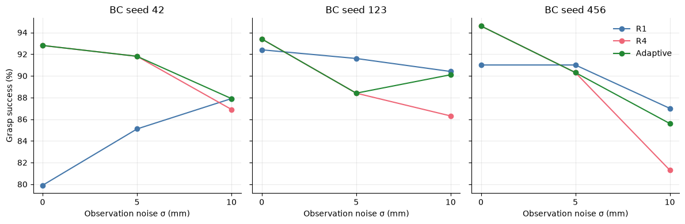
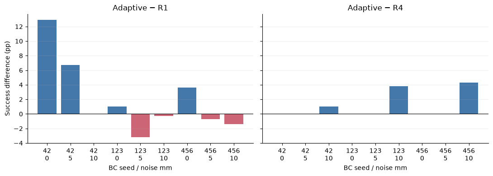
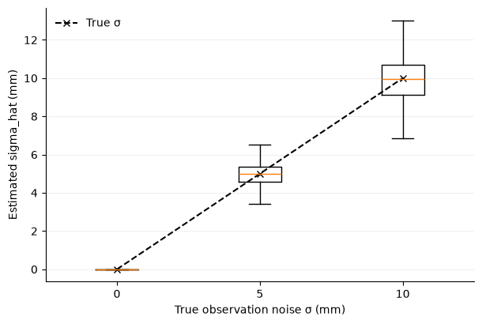
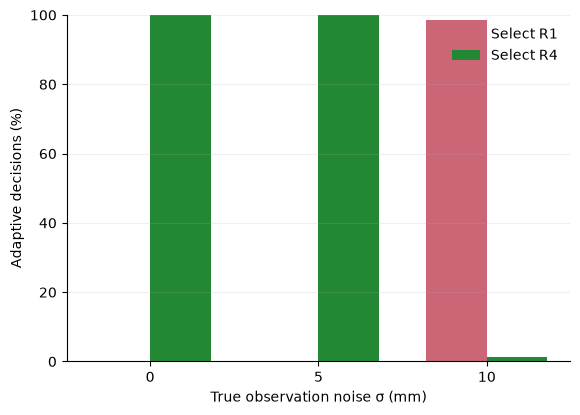
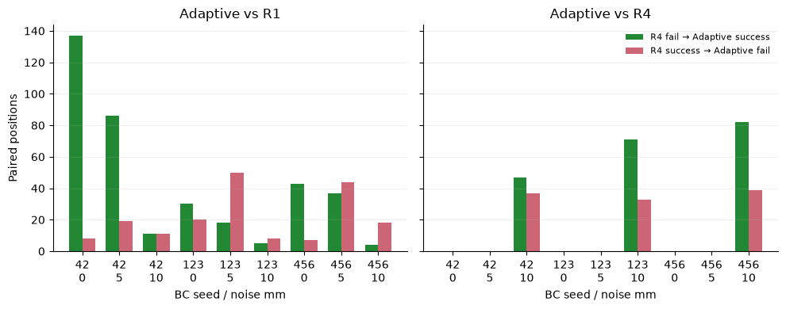
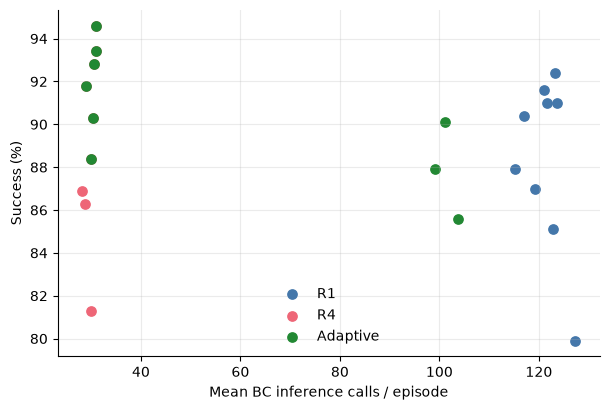

# Uncertainty-Aware Adaptive Replanning for Frozen H4 BC

**Status: Complete.** All 27 Final cells (27,000 episodes) passed the complete integrity audit. The frozen 7.5 mm Calibration threshold was unchanged. The hardware transfer was validated on 36 previously recorded smoke conditions, all 33 unit tests passed, and all three checkpoint hashes remained unchanged. Six English figures are provided in SVG and PNG. The historical 21-cell progress audit is retained unchanged.

## 1. Abstract

We tested an episode-level uncertainty rule on three frozen, state-conditioned H4 behavior-cloning policies under synthetic XY observation noise of 0, 5, and 10 mm. The controller executed R4 for 20 steps, estimated noise from accessible cube-position observations, then selected R4 at or below a Calibration-frozen 7.5 mm threshold or R1 above it. No training or model updates were performed. Across 27,000 audited Final episodes, equal-weighted success was 90.54% for Adaptive, 88.48% for fixed R1, and 89.53% for fixed R4 (the Calibration-selected fixed baseline). Adaptive improved over R4 by 1.01 percentage points (paired position-bootstrap 95% interval 0.54–1.50 pp) and over R1 by 2.07 pp (1.40–2.74 pp). It exactly preserved R4 trajectories at 0 and 5 mm, while improving mean 10 mm success from 84.83% to 87.87%; fixed R1 still achieved 88.43% at 10 mm. Benefits were heterogeneous and included harmful transitions. These results are conditional on three frozen policies and the specified synthetic benchmark, with timing confounded by hardware/run blocks.

## 2. Background and Motivation

The preceding H4 observation-noise study found that the relative R4 advantage declined as synthetic XY observation noise increased, with the direction and size depending on the frozen BC training seed. This motivates a transparent test of whether noisy observations can drive a coarse episode-level replanning choice. The present rule makes one decision after a 20-step R4 warm-up; it does not adapt continuously.

## 3. Research Questions and Hypotheses

The questions and hypotheses are preregistered in `bc_results/h4_adaptive_replanning_protocol.json`. They concern noise estimation from accessible observations, the performance of adaptive versus fixed R1/R4, preservation of clean-observation performance, reduction of noisy-condition harm, and heterogeneity across the three frozen models. No positive outcome is presumed.

## 4. Related Work

Action Chunking with Transformers (ACT) predicts action sequences for bimanual manipulation; Diffusion Policy learns a conditional action-sequence distribution and uses receding-horizon execution. ResiP augments a frozen chunked behavior-cloning policy with a learned, closed-loop RL residual. ResFiT is likewise an RL fine-tuning approach for behavior-cloned policies. Recent test-time chunk execution work such as PACE chooses execution boundaries from predicted action profiles, while RAIN predicts whether action proposals need refinement. This experiment does not claim adaptive replanning as a novel idea. Its contribution is a controlled, frozen-policy comparison of a simple observation-variance threshold, explicitly separating the R4 warm-up from the later choice and auditing paired trajectories.

## 5. Frozen Models and Environment

The exact checkpoints are `bc_models/action_chunking/H4_seed{42,123,456}.pt`; their SHA-256 digests and the source commit are frozen in the protocol. The existing Franka environment, H4 architecture, observation normalization, action ranges, gripper convention, physics, reward, and success rule are unchanged. There is no training, SAC, policy update, or checkpoint selection.

| BC training seed | Checkpoint SHA-256 |
|---:|---|
| 42 | `41cda0af609e3064ba8e485a4ef81289c319472b08d1f710d96b30f6cb470557` |
| 123 | `5dc02a9b9cce85b93beb18288c0681c90e5174181210cd4c0c23d518d653495c` |
| 456 | `649e42de42f0a04a2dc180dfa513afbbc52aba2e78f4f6c28a3deb41eb3cd706` |

## 6. Observation Uncertainty Estimation

Independent, zero-mean Gaussian errors are applied only to observed cube XY and matching relative XY entries, using the existing noise generator at σ = 0, 5, or 10 mm. True state and physics remain unchanged. The estimator is

`sigma_hat = sqrt((sample_var(x, ddof=1) + sample_var(y, ddof=1))/2)`

over noisy cube XY at observation times 0–19. It receives no true σ, clean coordinates, error vector, environment hidden state, evaluation seed feature, or outcome label. The first 20 actions execute from R4 chunks; at the chunk boundary after step 20 the controller selects R4 if `sigma_hat <= threshold`, else R1 for the rest of the episode. If termination occurs before a decision, no switch is made.

Before Calibration, 720 smoke episodes on seeds 333000–333019 passed completeness, pairing, switch timing, and branch-equivalence checks. Across all models and noise levels, maximum ground-truth cube displacement in the first 20 steps was **1.90e−10 m**, below the preregistered 1 mm stationarity criterion. Ground truth was used only for this audit. Smoke `sigma_hat` medians were 0, 5.075, and 10.150 mm for true σ of 0, 5, and 10 mm (60 episodes per level). The smoke threshold was used only to exercise code; it did not inform Calibration selection.

The earlier 540-episode smoke run used an earlier protocol-file SHA. It is retained with that hash as preliminary software evidence and excluded from threshold selection; the official post-amendment smoke2 is the 720-episode run above. A pre-Final reporting correction makes `region` derive from initial reset position rather than terminal cube position. Calibration does not select thresholds by region, and the Final audit verifies each initial-position region.

## 7. Adaptive Replanning Controller

R1 always replans at every step. R4 consumes each four-action chunk. Adaptive executes R4 for 20 control steps, estimates uncertainty once, and then continues at one fixed interval for the remainder. This is episode-level switching, not per-step adaptation. Switching occurs on a four-action boundary, avoiding half-consumed chunks. Adaptive versus Fixed R1 is an end-to-end comparison because R1 does not share the R4 warm-up; Adaptive versus Fixed R4 shares the first 20-step trajectory.

An additional warm-up-matched branch executes R4 for 20 steps, then R1 regardless of uncertainty. Smoke verified for 180 model/noise/seed combinations that Adaptive's outcome and trajectory counters exactly matched the selected complete branch: Fixed R4 when it selected R4, or the separately executed warm-up-matched R1 branch when it selected R1. Calibration therefore derives each candidate's complete adaptive outcome from these verified branches; it never substitutes a full-episode Fixed R1 label for a switched trajectory.

## 8. Preregistration and Calibration

The protocol SHA-256 is recorded in `bc_results/h4_adaptive_replanning_protocol.sha256`. Calibration uses 300 shared positions per BC seed and noise level. One global threshold is selected from 5.0, 7.5, and 10.0 mm by equally weighted success across nine model-seed × noise cells. Ties are resolved by fewer inference calls, then the smaller threshold. Fixed R1/R4 are measured on the same seeds; the better fixed method is selected from Calibration only. The frozen threshold is stored before Final begins.

Calibration completed with 300 shared evaluation seeds for each of 3 BC seeds × 3 noise levels, yielding 2,700 episodes per executed branch and 8,100 complete rollouts across Fixed R1, Fixed R4, and Warmup-R1. The three candidate adaptive outcomes were derived from complete, smoke-verified paths: select the Fixed R4 trajectory when the R4-prefix estimate is under threshold, otherwise the separately executed Warmup-R1 trajectory. Fixed R1 labels were not used to stand in for a switched R1 trajectory.

| Global threshold | Equal-weighted Adaptive success | Mean inference calls/episode | R1 selection at 0 / 5 / 10 mm |
|---:|---:|---:|---:|
| 5.0 mm | 90.852% | 66.39 | 0% / 47.3% / 100% |
| **7.5 mm (selected)** | **91.037%** | **54.07** | **0% / 0% / 99.0% |
| 10.0 mm | 90.630% | 41.38 | 0% / 0% / 47.3% |

Fixed R1 achieved an equal-weighted 88.963% with 121.26 mean inference calls; Fixed R4 achieved 90.222% with 29.83 calls. Fixed R4 was the Calibration-selected fixed baseline. The threshold was selected solely by the preregistered highest-success rule (no tie-break was needed) and is frozen in `bc_results/h4_adaptive_replanning/frozen_threshold.json` before Final.

The estimator's Calibration mean/median estimates were approximately 0/0 mm for true 0 mm, 4.959/4.959 mm for true 5 mm, and 9.919/9.919 mm for true 10 mm (900 estimates per level). Nearest nominal-sigma bucket agreement was 100%, 100%, and 99.0%, respectively; this is a descriptive diagnostic, not an input to the controller.

## 9. Final Evaluation Protocol

Final covers seeds 331000–331999 for each of three controllers, three BC models, and three noise conditions: 27,000 episodes. All conditions share initial positions and absolute-step-indexed noise. Each cell is written append-safely to a separate CSV with checkpoint/protocol/noise hashes. A clean interruption leaves `.partial.csv` files that the evaluator resumes after validating schema, order, uniqueness, and provenance. Do not edit conditions based on Final outcomes.

Final integrity audit: **27/27 cells complete, 27,000/27,000 rows, no partial files.** Each cell contains exactly the ordered seeds 331000–331999, correct frozen model/protocol metadata, paired base/applied noise schedules, and correct initial-position regions reconstructed by seeded resets. The full audit is `bc_results/h4_adaptive_replanning/final_integrity_audit.json`. All 21 previously completed CSVs are byte-identical to their hashes in the retained historical `final_progress_audit.json`; the remaining six cells were computed on the target Mac. Final performance was first opened after this complete audit passed. Independent analysis QA is in `final_analysis_qa.json`.

## 10. Success Rate Results

| BC seed | Noise (mm) | R1 (%) | R4 (%) | Adaptive (%) |
|---|---|---|---|---|
| 42 | 0 | 79.90 | 92.80 | 92.80 |
| 42 | 5 | 85.10 | 91.80 | 91.80 |
| 42 | 10 | 87.90 | 86.90 | 87.90 |
| 123 | 0 | 92.40 | 93.40 | 93.40 |
| 123 | 5 | 91.60 | 88.40 | 88.40 |
| 123 | 10 | 90.40 | 86.30 | 90.10 |
| 456 | 0 | 91.00 | 94.60 | 94.60 |
| 456 | 5 | 91.00 | 90.30 | 90.30 |
| 456 | 10 | 87.00 | 81.30 | 85.60 |

Each entry represents 1,000 episodes. Equal-weighted means over the nine model × noise cells are **88.48%, 89.53%, and 90.54%**, respectively (7,963 / 8,058 / 8,149 successes out of 9,000 per controller). Per-noise means across models are:

| Noise (mm) | R1 (%) | R4 (%) | Adaptive (%) |
|---|---|---|---|
| 0 | 87.77 | 93.60 | 93.60 |
| 5 | 89.23 | 90.17 | 90.17 |
| 10 | 88.43 | 84.83 | 87.87 |

## 11. Comparison with Fixed R1/R4

Adaptive versus fixed R1 is an end-to-end comparison because R1 does not share the R4 warm-up; Adaptive versus fixed R4 shares the first 20-step trajectory. R4 was selected as the fixed baseline from Calibration, not Final. The comparison against the Calibration-selected baseline therefore duplicates Adaptive versus R4 and supplies no independent third result.

| Contrast | Equal-weight difference (pp) | Paired bootstrap 95% interval (pp) |
|---|---|---|
| Adaptive − R1 | +2.07 | [+1.40, +2.74] |
| Adaptive − R4 / Calibration baseline | +1.01 | [+0.54, +1.50] |

Adaptive minus R4, averaged over noise within each model, was +0.33, +1.27 and +1.43 pp for seeds 42, 123 and 456 (3/3 positive; sample SD 0.59 pp). Adaptive minus R1 was +6.53, −0.83 and +0.50 pp (2/3 positive; sample SD 3.93 pp). Thus the aggregate advantage over R1 is not shared by every model. No controller was selected or tuned from Final.

## 12. Uncertainty Estimation Accuracy

All 9,000 Adaptive episodes reached the decision boundary. Each noise-level diagnostic pools 3,000 model-position episodes; the same 1,000 position/noise seeds are shared across models and are not independent noise replications. Estimated sigma mean/median was approximately 0/0 mm, 4.980/4.977 mm, and 9.959/9.953 mm for true noise 0/5/10 mm. Nearest nominal-sigma bucket agreement was 100%, 100%, and 98.6%, respectively. This classification is a diagnostic only; the controller never receives true sigma.

At 0 and 5 mm, Adaptive selected R4 in all 3,000 episodes per noise level. At 10 mm, it selected R1 in 2,958 episodes (98.6%) and R4 in 42 (1.4%). All 6,042 selected-R4 trajectories matched paired fixed-R4 outcomes and non-timing trajectory fields exactly. Maximum initial-window ground-truth displacement over Final was 2.01e−10 m, below the 1 mm stationarity criterion.

Conditional success was 93.60% for selected R4 at 0 mm and 90.17% at 5 mm. At 10 mm, selected R1 succeeded in 2,600/2,958 episodes (87.90%) and selected R4 in 36/42 (85.71%). These groups are selected by the estimate and are not randomized comparisons.

## 13. Beneficial and Harmful Outcome Analysis

A beneficial transition means baseline failure → Adaptive success; a harmful transition means baseline success → Adaptive failure. These are paired controller comparisons, not SAC rescue/regression measurements.

| BC seed | Noise (mm) | Benefit vs R1 | Harm vs R1 | Benefit vs R4 | Harm vs R4 |
|---|---|---|---|---|---|
| 42 | 0 | 137 | 8 | 0 | 0 |
| 42 | 5 | 86 | 19 | 0 | 0 |
| 42 | 10 | 11 | 11 | 47 | 37 |
| 123 | 0 | 30 | 20 | 0 | 0 |
| 123 | 5 | 18 | 50 | 0 | 0 |
| 123 | 10 | 5 | 8 | 71 | 33 |
| 456 | 0 | 43 | 7 | 0 | 0 |
| 456 | 5 | 37 | 44 | 0 | 0 |
| 456 | 10 | 4 | 18 | 82 | 39 |

The descriptive totals are 371 beneficial / 185 harmful versus R1 (net +186 successes), and 200 beneficial / 109 harmful versus R4 (net +91). These totals reuse positions across models/noise and are not independent-sample tests. Every cell satisfies success-count difference = beneficial − harmful. All R4 transitions occurred at 10 mm. Among switched-R1 episodes, 37/33/39 failures for models 42/123/456 had successful paired R4 trajectories; this is a counterfactual diagnostic, not proof that a particular uncertainty estimate was erroneous.

Exploratory initial-position regions contain EN=231, ES=269, WN=257 and WS=243 positions per model/noise. At 10 mm, pooled Adaptive versus R4 success was 94.37% versus 90.62% (EN), 97.65% versus 95.54% (ES), 80.93% versus 75.23% (WN), and 78.19% versus 77.64% (WS). These regional averages hide model heterogeneity and are descriptive; full model-specific counts are in `final_summary.json`.

## 14. Inference Cost

| Controller | Calls/episode | Inference ms/episode | Wall seconds/episode | Control steps/episode |
|---|---|---|---|---|
| R1 | 121.258 | 4.725 | 0.375 | 121.258 |
| R4 | 29.830 | 1.621 | 0.364 | 117.999 |
| Adaptive | 53.930 | 2.424 | 0.367 | 118.902 |

Adaptive used 55.52% fewer model calls than R1 and 80.79% more than R4. The mean per-call latency computed from total milliseconds / total calls was approximately 0.0390 ms (R1), 0.0544 ms (R4), and 0.0449 ms (Adaptive). Adaptive's observed mean wall time was only 2.25% lower than R1 and 0.80% higher than R4. These measurements exclude environment construction/reset, because the evaluator starts the timer after reset; they are not total experiment elapsed time or physical robot speed measurements.

Timing is descriptive: the six seed-456/5 and 10 mm cells ran on a different Mac from the other 21 cells; run order and load were not interleaved or controlled. Aggregate inference-time and wall-time contrasts therefore mix hardware/run blocks. Model-call counts are hardware independent, but also reflect differing episode lengths. Raw cell timing is retained in `final_cell_summary.csv`.

## 15. Statistical Interpretation

The preregistered analysis uses 10,000 paired position bootstrap resamples. A shared index vector preserves correspondence across controllers, models and noise levels in each overall resample; the reported intervals condition on these three frozen policies. Exact two-sided McNemar tests are performed within each model/noise cell, with Holm adjustment across nine cells separately for each baseline comparison family. The duplicate Calibration-baseline comparison is not an additional test family.

| BC seed | Noise (mm) | Adaptive − R1: pp / Holm p | Adaptive − R4: pp / Holm p |
|---|---|---|---|
| 42 | 0 | +12.90 / 1.705e-30 | +0.00 / 1 |
| 42 | 5 | +6.70 / 1.843e-10 | +0.00 / 1 |
| 42 | 10 | +0.00 / 1 | +1.00 / 1 |
| 123 | 0 | +1.00 / 0.8106 | +0.00 / 1 |
| 123 | 5 | -3.20 / 0.000785 | +0.00 / 1 |
| 123 | 10 | -0.30 / 1 | +3.80 / 0.001977 |
| 456 | 0 | +3.60 / 1.469e-06 | +0.00 / 1 |
| 456 | 5 | -0.70 / 1 | +0.00 / 1 |
| 456 | 10 | -1.40 / 0.02172 | +4.30 / 0.001039 |

Against R4 at 10 mm, the effects were +1.0, +3.8, and +4.3 pp; Holm-adjusted p-values were 1.0, 0.00198, and 0.00104 for seeds 42/123/456. Against R1, Adaptive was significantly worse for seed 123 at 5 mm (−3.2 pp, adjusted p=0.000785) and seed 456 at 10 mm (−1.4 pp, adjusted p=0.0217). The complete per-cell intervals and unadjusted/adjusted tests are retained in `final_paired_comparisons.csv`. Exact p-values were independently checked against SciPy's binomial test.

The positive overall bootstrap intervals quantify position uncertainty within this benchmark; they do not establish population-level superiority across future training runs. Only three independently trained policies were tested. Shared positions and noise schedules do not increase the number of policy-training replications. No population-level seed confidence interval or pooled independent-episode significance claim is made.

## 16. Failure Analysis

No Final episode ended before the 20-step decision. There was no checkpoint change, stationarity violation, partial cell or failed integrity check. At 10 mm, 1.4% of estimates remained under the threshold and selected R4; these low-estimate episodes are a limitation of finite-window noise estimation, but their aggregate outcomes do not establish that switching would have helped each episode.

Accurate noise classification does not imply optimal controller selection. At 5 mm, Adaptive always chose R4; this retained a −3.2 pp disadvantage versus R1 for seed 123. At 10 mm, Adaptive improved over R4 but remained below fixed R1 on average (87.87% versus 88.43%). The R4 warm-up and the small set of under-threshold episodes differ from full-episode R1; this experiment does not causally isolate these two sources. Harmful switched transitions existed even where the net effect was positive. There is no evidence here for a universally best interval or a model-independent optimal noise threshold.

## 17. Limitations

Only three independent BC training seeds are available. Evaluation positions and noise schedules are paired across conditions and do not create independent policy-training replications. The noise is synthetic Gaussian state-observation perturbation, not camera occlusion or realistic perception drift. The stationarity assumption is supported by the specific initial 20-step smoke audit, not guaranteed in other tasks or controller configurations. The decision is coarse and episode-level. Execution timing is hardware-load sensitive.

## 18. Implications for Reliable Robotic Manipulation

The frozen observation-variance rule preserved the paired R4 trajectories at 0 and 5 mm and improved mixed-noise success over the Calibration-selected fixed baseline. This supports a narrow benchmark claim: a transparent uncertainty statistic can guide an episode-level execution choice without retraining. It does not show that continuous adaptation, learned perception uncertainty, or real-world manipulation has been solved. The earlier H1-versus-H4 architecture comparison and this frozen-H4 execution study answer different questions.

A concise Statement of Purpose description is:

> I investigated how observation uncertainty should influence execution of a frozen action-chunked policy. In 27,000 paired simulated Franka evaluations across three trained policies, a calibration-selected variance threshold improved mean success from 89.53% for fixed four-step execution to 90.54%, while retaining its clean-observation trajectories. Analyzing harmful transitions and model-specific exceptions taught me to distinguish reliable uncertainty estimation from reliable control selection, and to qualify gains by their evaluation conditions.

These audited results can be reported for the present application without expanding the current experiment. Broader claims would require separate evidence.

## 19. Future Work

A separate, preregistered study could test more independently trained policies and realistic temporally correlated perception errors. Distinguishing warm-up effects from selection effects would require additional matched branches on a new held-out set. These studies, new BC/SAC training, and portfolio-repository changes are outside the completed experiment's scope.

## 20. Reproduction Instructions

The existing smoke audits are already saved; their scripts refuse to overwrite them. Re-run an audit only in a fresh reproduction output directory. Calibration is already complete and frozen at threshold `0.0075` (7.5 mm) in `bc_results/h4_adaptive_replanning/frozen_threshold.json`. On a fresh Mac, copy all three ignored model checkpoints, verify hashes, install the recorded environment and Franka assets, then verify the completed seed-456 cells with `.venv/bin/python evaluate_h4_adaptive_replanning.py --phase final --model-seed 456 --threshold 0.0075`. All nine seed-456 cells now exist, so this command validates and skips them. At transfer time it skipped the three 0 mm cells and computed the remaining six. No archived study CSV should be removed or edited. The evaluator resumes validated `.partial.csv` files. To stop cleanly at a complete cell boundary, create `bc_results/h4_adaptive_replanning/.STOP_AFTER_CELL`; after the process exits, remove that marker before resuming. The existing full audit and analysis are already saved and their scripts refuse to overwrite them. For a fresh reproduction, use `audit_h4_adaptive_replanning_final.py --allow-incomplete` for count-only progress before completion, or the same audit without the flag once all 27 cells are complete; preserve existing audit snapshots before creating a new one. For a full independent rerun, use a separate checkout and archive that checkout's existing Final CSV/metadata, audits, summaries and figures outside its evaluator output directory; retain the frozen threshold and calibration evidence. Run the Final evaluator sequentially with `--model-seed 42`, `123` and `456` at threshold `0.0075`, then the complete audit, then `MPLCONFIGDIR=/private/tmp/matplotlib-h4 .venv/bin/python analyze_h4_adaptive_replanning.py`. The original checkout and its evidence remain intact. The global `.study_run.lock` prevents concurrent writers.

Checkpoint transfer correction: none of the three H4 checkpoints is tracked in this branch. All three `.pt` files must be transferred unchanged to the paths in Section 5 and their hashes verified. No model files were committed by this study.

The target system is a Mac Studio with Apple M1 Max and 32 GB memory. Python 3.12.10, NumPy 2.5.4, PyTorch 2.15.0, MuJoCo 3.17.0, and Gymnasium 1.4.0 match the earlier recorded software versions. Full package pins are in `bc_results/h4_adaptive_replanning/hardware_transfer_requirements.txt`; the exact Menagerie commit, Franka asset hashes, model configuration and normalization hashes are in `hardware_transfer_audit.json`. On a fresh installation, create a Python 3.12.10 virtual environment at `.venv`, install those pins, clone `https://github.com/google-deepmind/mujoco_menagerie.git` to `mujoco_menagerie`, check out commit `98a70c569c4c1b6da467a20012f766ee1f8dc521`, and materialize its `franka_emika_panda` directory.

Before resuming, seed 333000 from the existing smoke2 set was rerun across three models, three noise levels and four controllers (36 episodes). Outcomes, control counters, decisions and noise hashes matched, and floating trajectory fields matched with `rtol=atol=1e-9`; timing was excluded from equivalence. The full unit suite passed 33/33 after transferring the separate baseline checkpoint required only by legacy SAC tests; syntax checks passed for 78 Python files.

Pre-completion analysis QA found that pooled noise-level estimator, switch and conditional-success diagnostics were overwritten on each model iteration. This was corrected before inspecting Final outcomes, with a synthetic-data regression covering all three policies and early termination. Evaluation, calibration, thresholds, success comparisons and bootstrap definitions were unchanged.

Timing provenance: the previous Mac produced all seed-42/123 cells and seed-456/0 mm cells; the target Mac produced seed-456/5 and 10 mm cells. Aggregate wall-clock and inference-time comparisons mix hardware and run blocks and are descriptive. Model-call counts remain hardware independent.

### References

- Zhao et al., [Learning Fine-Grained Bimanual Manipulation with Low-Cost Hardware](https://arxiv.org/abs/2304.13705) (ACT).
- Chi et al., [Diffusion Policy: Visuomotor Policy Learning via Action Diffusion](https://arxiv.org/abs/2303.04137).
- Ankile et al., [From Imitation to Refinement—Residual RL for Precise Assembly](https://arxiv.org/abs/2407.16677) (ResiP).
- [Residual Off-Policy RL for Finetuning Behavior Cloning Policies](https://arxiv.org/abs/2509.19301) (ResFiT).
- Nie et al., [PACE: Phase-Aware Chunk Execution for Robot Policies with Action Chunking](https://arxiv.org/abs/2606.00537).
- Liu et al., [Refine Actions If Needed: Adaptive Action Chunk Refinement for Robot Manipulation](https://arxiv.org/abs/2610.19765) (RAIN).
