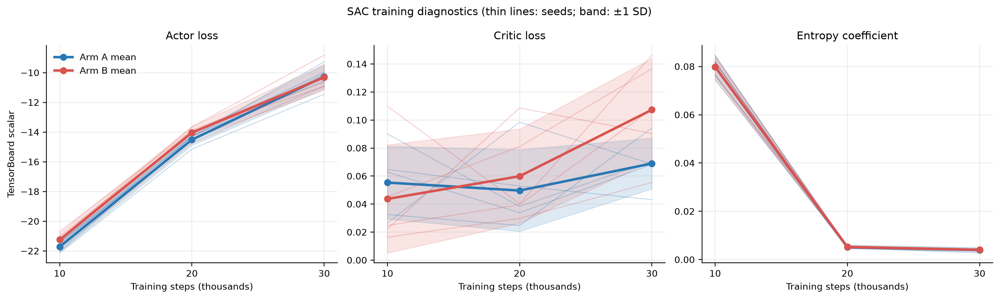
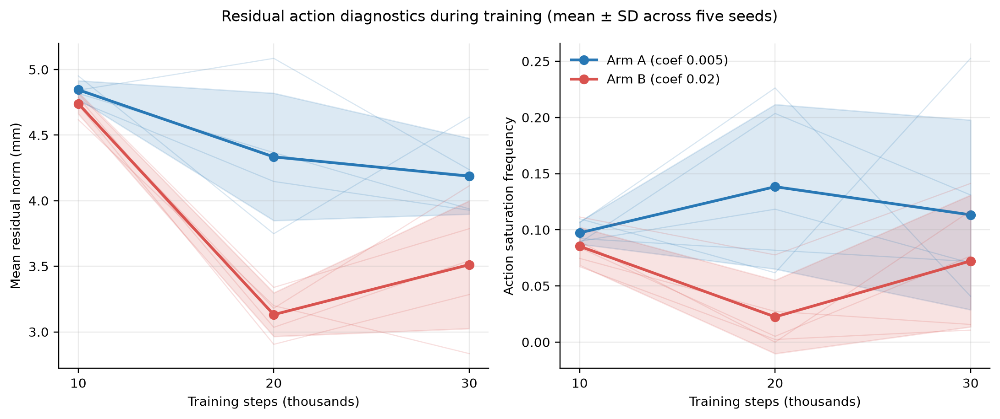
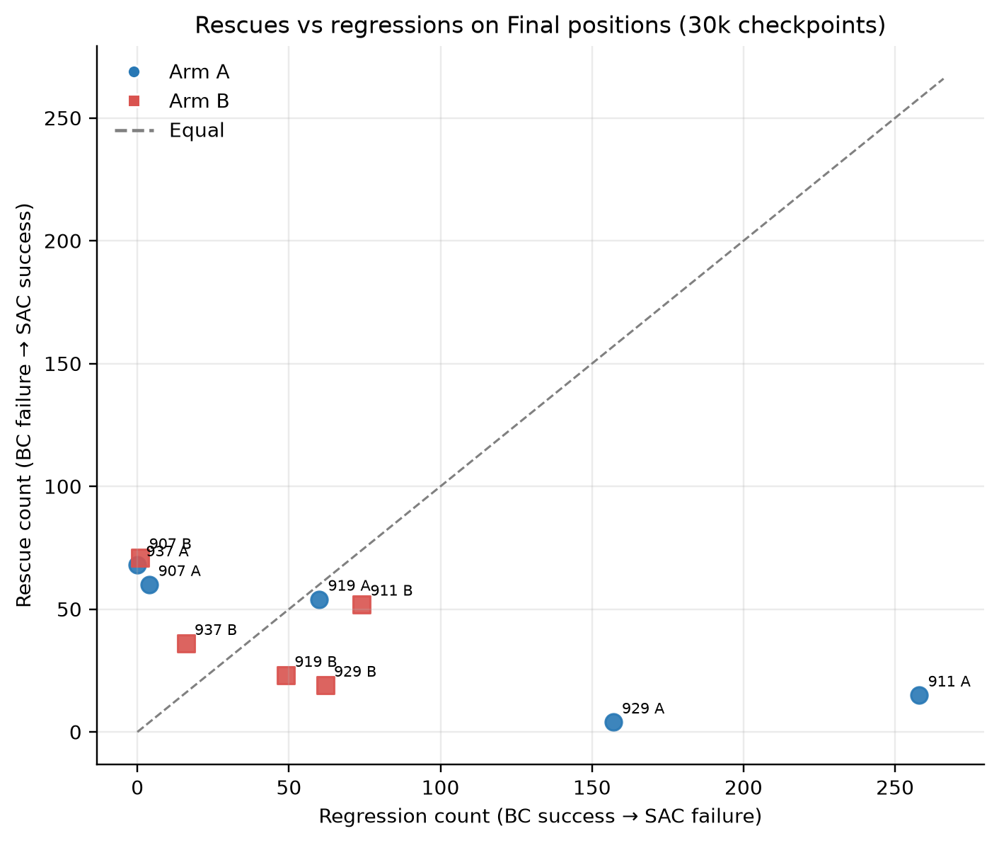
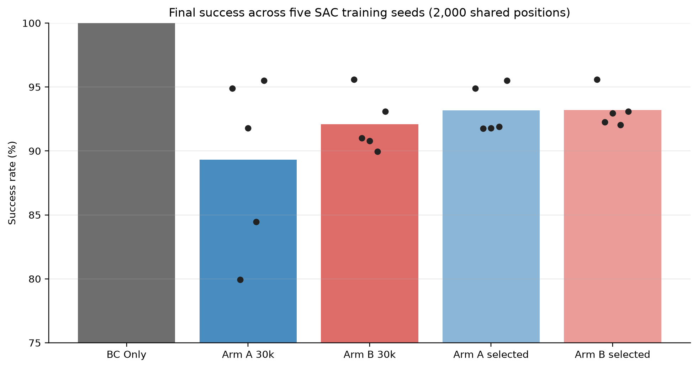

# SAC Regression Diagnostics & Controlled Regularization Experiment

## 1. Research Questions

This study asks whether stronger regularization of the residual SAC action can reduce regressions of successful Behavior Cloning (BC) behavior, while retaining useful rescue behavior, across different SAC training seeds. It also asks whether training-time residual-action and reward diagnostics help characterize observed regression, and whether the effects are consistent over training seeds.

The primary comparison is the fixed 30,000-step checkpoint from two otherwise matched SAC runs per seed. The secondary comparison uses a checkpoint chosen separately for each seed and regularization arm on a disjoint 500-position Validation B set.

## 2. Hypotheses

- **H1:** Increasing the residual action penalty from 0.005 (Arm A) to 0.020 (Arm B) reduces the number of BC-successful positions that become failures.
- **H2:** Arm B preserves overall success, with mean success no more than 0.5 percentage points below Arm A.
- **H3:** Arm B does not cause a large reduction in rescue count. Before opening Final outcomes, “no large decrease” was operationalized as a mean reduction of no more than 10 rescues per 2,000 positions.
- **H4:** Reduced residual action magnitude and saturation will accompany reduced regressions. This is a descriptive mechanism hypothesis; the experiment is not designed to establish mediation or causation.

## 3. Previous Findings

An audit of prior SAC training logs found examples of both improvement and degradation between checkpoints. For seed 811, 20k→30k improved on the prior final positions from 36 regressions/50 rescues to 4 regressions/83 rescues, while mean critic loss increased from 0.0412 to 0.0987. For seed 827, 10k→20k coincided with regressions increasing from 10 to 78, no rescue change (3), lower rollout success, and lower training reward. For seed 829, 20k→30k coincided with regressions rising from 6 to 89 and rescues falling from 59 to 45. These are observational checkpoint comparisons.

The old TensorBoard logs did not contain per-action residual diagnostics, reward-component breakdowns, direct TD errors, or Q1/Q2 disagreement. Critic loss is therefore not treated as a direct TD-error measurement or as a stand-alone regression explanation.

## 4. Existing Training Diagnostics

The Phase A audit and focused-transition tables are saved as:

- `bc_results/sac_regression_existing_tensorboard_metrics.csv`
- `bc_results/sac_regression_existing_metric_availability.csv`
- `bc_results/sac_regression_existing_validation_and_paired_outcomes.csv`
- `bc_results/sac_regression_focused_transition_diagnostics.csv`
- `bc_results/sac_regression_existing_diagnostics_summary.json`

They preserve the distinction between available rollout/training metrics and unavailable action/Q diagnostics. The strongest qualitative warning from the audit is that critic-loss movement alone did not track final regression consistently.

## 5. Controlled Experimental Design

The study used five preregistered SAC training seeds (907, 911, 919, 929, 937), with two arms for each seed. Both arms used the same SAC settings, BC checkpoint, training position distribution, reward shaping, and evaluation code; the only intended training-condition difference was the residual-action penalty coefficient:

| Arm | Residual action penalty coefficient |
|---|---:|
| A | 0.005 |
| B | 0.020 |

Each run trained for 30,000 steps and saved immutable snapshots at 10k, 20k, and 30k. The shared BC model was `bc_models/fair_wide_expert_seed42.pt`. Evaluation used deterministic policy inference, the existing MuJoCo success criterion and episode limit, cube positions in the configured ±20 cm evaluation region, and the environment’s existing per-axis residual bounds (±5 mm per axis). All policies were evaluated on the same positions.

Validation A was the existing 40-position training validation sequence. Validation B used positions seeded 230000–230499 (500 episodes) and selected checkpoints using highest success rate, then fewest paired regressions, shorter mean successful-episode length, and earlier checkpoint as tie-breakers. The selected step and model/validation hashes were frozen before Final evaluation. Final used the disjoint range 240000–241999 (2,000 episodes); prior final ranges 150000–151999, 170000–171999, 190000–191999, and 220000–221999 were excluded. One shared BC-only baseline was evaluated on Final, and each SAC result was paired against it.

All 10 training runs completed with the expected snapshots, configuration, evaluation history, replay/resume state, and per-episode diagnostics. Model weights and replay buffers remain local and are not included in the shareable experiment artifacts.

## 6. Residual Action Regularization

The controlled environment change exposes `residual_penalty_coefficient` (default 0.005); the earlier abbreviated `residual_penalty_coef` keyword remains a backward-compatible alias. It logs the task reward, shaping reward, residual-action penalty, normalized residual norm, commanded and applied corrections, clipping difference, and action saturation. The trainer records per-episode aggregates from the existing rollout info and does not add environment steps for diagnostics. The default run settings were preserved for Arm A; Arm B used 0.020. No SAC weights were changed after training, and no evaluation outcomes were used to alter conditions.

On the 30k Final evaluations, Arm B’s mean applied-command residual norm was 3.12 mm across seeds, versus 4.06 mm for Arm A. Mean action-saturation frequency was 4.48% for B and 7.13% for A. The association is consistent with the intended regularization effect, but the saturation response varied by seed and is not evidence that residual magnitude alone caused success changes.

## 7. Training Metrics

Actor loss, critic loss, entropy coefficient, training reward, rollout success/episode length, residual action norms, saturation, and reward components are summarized by seed, arm, and checkpoint window in `bc_results/sac_regdiag_training_diagnostics.csv`. The 30k checkpoint’s validation-A success ranged from 80% to 100% across the five Arm A runs and 95% to 100% across Arm B runs; the 40-episode validation is coarse. Validation B checkpoint results are in `bc_results/sac_regdiag_validation_metrics.csv`.

Training-time mean residual norm generally declined from the early checkpoint window under Arm B. Actor and critic losses varied by seed and step; they should be read alongside outcomes, not as direct estimates of policy safety. The study did not record direct TD errors or Q1/Q2 disagreement. Training diagnostics are observational and do not establish a mechanism for final outcomes.





## 8. Final Results

The shared BC baseline succeeded on **1,842/2,000 (92.10%)** Final positions. The table below reports the fixed 30k checkpoints. Rescue is BC failure→SAC success; regression is BC success→SAC failure; net is rescue minus regression.

| SAC seed | Arm A success | A rescue | A regression | A net | Arm B success | B rescue | B regression | B net | B−A success (pp) |
|---:|---:|---:|---:|---:|---:|---:|---:|---:|---:|
| 907 | 1,898/2,000 (94.90%) | 60 | 4 | +56 | 1,912/2,000 (95.60%) | 71 | 1 | +70 | +0.70 |
| 911 | 1,599/2,000 (79.95%) | 15 | 258 | −243 | 1,820/2,000 (91.00%) | 52 | 74 | −22 | +11.05 |
| 919 | 1,836/2,000 (91.80%) | 54 | 60 | −6 | 1,816/2,000 (90.80%) | 23 | 49 | −26 | −1.00 |
| 929 | 1,689/2,000 (84.45%) | 4 | 157 | −153 | 1,799/2,000 (89.95%) | 19 | 62 | −43 | +5.50 |
| 937 | 1,910/2,000 (95.50%) | 68 | 0 | +68 | 1,862/2,000 (93.10%) | 36 | 16 | +20 | −2.40 |
| **Mean across seeds** | **89.32%** | **40.2** | **95.8** | **−55.6** | **92.09%** | **40.2** | **40.4** | **−0.2** | **+2.77** |

Across the five training seeds, the Arm B−A success difference had sample SD 5.51 pp and ranged from −2.40 to +11.05 pp. Regression-count differences (B−A) averaged −55.4 (SD 83.5; range −184 to +16). Rescue-count differences averaged 0.0 (SD 30.4; range −32 to +37). Thus, Arm B met all three preregistered aggregate decision criteria, but the effect was heterogeneous: it increased regressions for seed 937 and was not better on every seed.





The Validation-B-selected checkpoint results are secondary and are shown separately so they are not confused with the fixed-30k primary comparison:

| SAC seed | Selected A step | A success | A rescue / regression | Selected B step | B success | B rescue / regression |
|---:|---:|---:|---:|---:|---:|---:|
| 907 | 30k | 94.90% | 60 / 4 | 30k | 95.60% | 71 / 1 |
| 911 | 20k | 91.75% | 20 / 27 | 10k | 92.25% | 6 / 3 |
| 919 | 30k | 91.80% | 54 / 60 | 20k | 92.95% | 23 / 6 |
| 929 | 10k | 91.90% | 6 / 10 | 10k | 92.05% | 5 / 6 |
| 937 | 30k | 95.50% | 68 / 0 | 30k | 93.10% | 36 / 16 |
| **Mean** | — | **93.17%** | **41.6 / 20.2** | — | **93.19%** | **28.2 / 6.4** |

## 9. Rescue / Regression Analysis

Arm B had fewer regressions than Arm A in four of five seeds. It increased rescues in three seeds (907, 911, 929) and reduced them in two (919, 937). Rescue differences B−A were +11, +37, −31, +15, and −32 for seeds 907, 911, 919, 929, and 937. The high-rescue Arm A result for seed 937 was partially lost under the stronger penalty, along with 16 regressions appearing. Conversely, the severe seed 911 Arm A regression problem (258) was much smaller under B (74), with success rate rising by 11.05 pp. These examples show a rescue–regression trade-off that is hidden by a mean success rate alone.

At 30k, pooled over the five runs (positions repeat across seeds and are not treated as 10,000 independent training observations), the quadrant counts were:

| Region | Evaluated rows across five models | Arm A rescues | Arm A regressions | Arm B rescues | Arm B regressions |
|---|---:|---:|---:|---:|---:|
| EN | 1,645 | 42 | 62 | 51 | 23 |
| ES | 1,405 | 51 | 1 | 23 | 95 |
| WN | 1,735 | 38 | 89 | 65 | 22 |
| WS | 1,710 | 70 | 326 | 62 | 62 |
| Inside ±12 cm | 3,505 | 0 | 1 | 0 | 0 |

The larger regression burden under Arm A was concentrated in WS; Arm B also showed a trade-off in ES, where regressions rose from 1 to 95 while rescues fell. The regional CSV contains per-seed counts and success rates; pooled rows above summarize repeated position sets and are descriptive only.

## 10. Statistical Analysis

For each SAC seed, exact paired McNemar tests compare Arm B against Arm A on the shared Final positions, with separate families for overall success, regressions conditional on BC success, and rescues conditional on BC failure. Holm correction is applied across the five seed-specific tests within each family. The per-seed tests condition on the trained policies and this fixed position set; they do not estimate the distribution over future SAC training seeds. Because every training seed used the same Final positions, cross-seed test results are dependent. They must not be counted as five independent replications of the position sample.

In the fixed-30k comparison, Holm-adjusted evidence favored B over A for overall success and fewer regressions in seed 911 (overall p=4.31×10⁻³¹; regression p=2.17×10⁻²⁶) and seed 929 (p=1.36×10⁻¹⁴; regression p=2.36×10⁻¹²). Seed 937 favored A (overall p=2.13×10⁻¹⁴; regression p=9.16×10⁻⁵). Seeds 907 and 919 did not show Holm-adjusted overall success differences. These per-seed position-level results are conditional evidence, not a population-level claim.

For Validation-B-selected checkpoints, mean success was 93.17% in A and 93.19% in B (mean difference +0.02 pp). B reduced mean regression count from 20.2 to 6.4 but had 13.4 fewer rescues on average (41.6 vs 28.2). The direction varied: B reduced regressions in four of five seeds but seed 937 favored A; the minimal mean success difference does not make this a consistent improvement. In seed 911 and seed 919 selected comparisons, B had substantially fewer regressions, while seed 937’s selected 30k comparison again favored A. Full exact and Holm-adjusted results are in `bc_results/sac_regdiag_exact_mcnemar_tests.csv`.

The primary analysis treats the **five training seeds** as the units for cross-seed summaries and reports their mean, sample SD, and range. This small number of training runs provides weak precision for generalizing to new seeds. No position-level p-value is interpreted as replacing that limitation.

## 11. Discussion

The results support the controlled-regularization hypothesis for reducing regressions in most, but not all, tested training runs. At 30k, the stronger penalty lowered the average regression count by 55.4 per 2,000 positions while preserving the mean rescue count and increasing mean success by 2.77 pp relative to Arm A. It also reduced mean residual norm and, overall, saturation frequency. Yet the seeds had a wide spread, and seed 937 reversed the regression direction. Arm B’s mean success (92.09%) was nearly equal to BC’s 92.10%, so the aggregate benefit is chiefly relative to Arm A’s poor average and is not a consistent improvement over BC.

Validation-B checkpoint selection improved the mean selected checkpoint success compared with fixed 30k (93.17% A and 93.19% B vs 89.32% and 92.09%, respectively), but the selected-vs-30k comparison is descriptive and selection uses a finite validation set. Selection reduces regression counts, particularly in seeds 911 and 919, but can also reduce rescue counts. It should be confirmed with additional untouched test sets.

The action diagnostics align with lower residual magnitude under the stronger penalty, but they do not explain all seed-specific outcomes. For example, seed 937’s 30k Arm B had lower mean residual norm and saturation than A but also 16 regressions versus none for A and 32 fewer rescues. Actor/critic losses, entropy coefficient, residual action, and task outcomes jointly describe learning; none were experimentally manipulated independently to isolate why that seed behaved differently.

## 12. Limitations

- Only five paired SAC training seeds were tested; effects and variability across a larger training-seed population remain uncertain.
- All models share the same evaluation positions. McNemar pairing accounts for BC/SAC or A/B outcomes within position, but repeated tests across models are dependent.
- Per-seed exact tests condition on fixed policies and positions and do not account for SAC retraining uncertainty.
- Validation B checkpoint selection can overfit its 500 positions. Final positions were disjoint, but the selected-checkpoint results remain secondary.
- Residual norm and saturation are observational correlates of regularization, not causal mediators.
- Direct TD errors and Q1/Q2 disagreement were not measured. Critic loss must not be substituted for them.
- The chosen penalty coefficients test two values and do not establish an optimal regularization strength.

## 13. Implications for Adaptive Gate Learning

This experiment strengthens the case for a gate to prevent harmful residual corrections in unstable runs, but it also shows that the residual policy’s useful rescue behavior can be reduced by stronger regularization. Future gate work should therefore optimize both conditional regression prevention and retained rescue opportunity, and should report outcomes by seed and position region. A policy-specific or adaptive gate should be calibrated and evaluated on disjoint position sets, with additional SAC training seeds and no final-set threshold tuning.

## 14. Reproduction Instructions

The experiment branch is `experiment/sac-regression-diagnostics`, based on commit `3037449bb64eb188627ac7b0a7804b34b40e5c54`. With the repository virtual environment and MuJoCo assets available, the high-level commands are:

```bash
MPLCONFIGDIR=/private/tmp/mplcache .venv/bin/python -m unittest \
  test_selective_residual_gate.py test_policy_specific_gate.py \
  test_sac_stability.py test_sac_regression_control.py
MPLCONFIGDIR=/private/tmp/mplcache .venv/bin/python analyze_sac_regression_diagnostics.py
MPLCONFIGDIR=/private/tmp/mplcache .venv/bin/python run_sac_regression_training.py
MPLCONFIGDIR=/private/tmp/mplcache .venv/bin/python run_sac_regression_evaluations.py validation
MPLCONFIGDIR=/private/tmp/mplcache .venv/bin/python freeze_sac_regression_selection.py
MPLCONFIGDIR=/private/tmp/mplcache .venv/bin/python run_sac_regression_evaluations.py final
MPLCONFIGDIR=/private/tmp/mplcache .venv/bin/python analyze_sac_regression_results.py
MPLBACKEND=Agg MPLCONFIGDIR=/private/tmp/mplcache \
  .venv/bin/python plot_sac_regression_results.py
```

`run_sac_regression_evaluations.py` resumes incomplete candidate CSVs and checks the frozen selection manifest. The output records include `sac_regdiag_validation_metrics.csv`, `sac_regdiag_checkpoint_selection_freeze.json`, final per-checkpoint paired CSVs, `sac_regdiag_final_checkpoint_metrics.csv`, `sac_regdiag_primary_seed_comparisons.csv`, `sac_regdiag_selected_seed_comparisons.csv`, `sac_regdiag_exact_mcnemar_tests.csv`, `sac_regdiag_regional_outcomes.csv`, `sac_regdiag_training_diagnostics.csv`, and `sac_regdiag_analysis_summary.json`. Five figures are saved as PNG and SVG in `bc_results/sac_regdiag_figures/`. Model checkpoints and replay buffers are excluded from version control.
