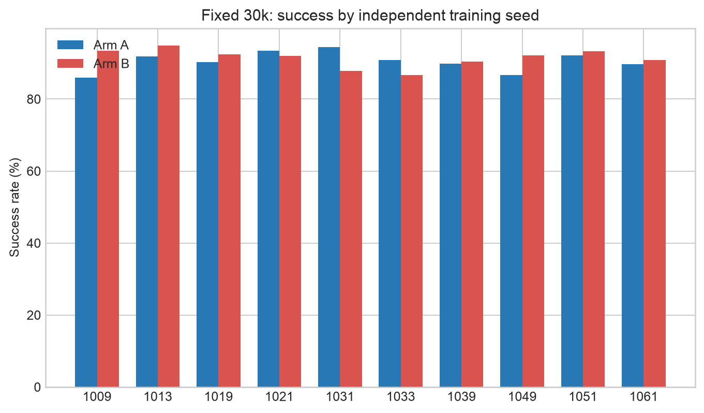
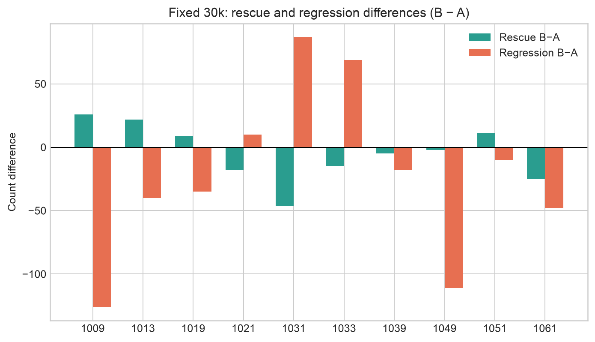
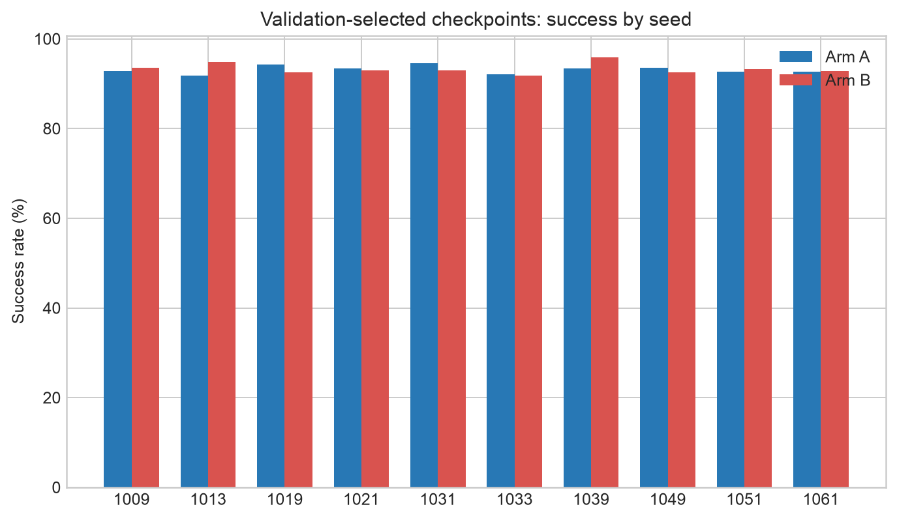
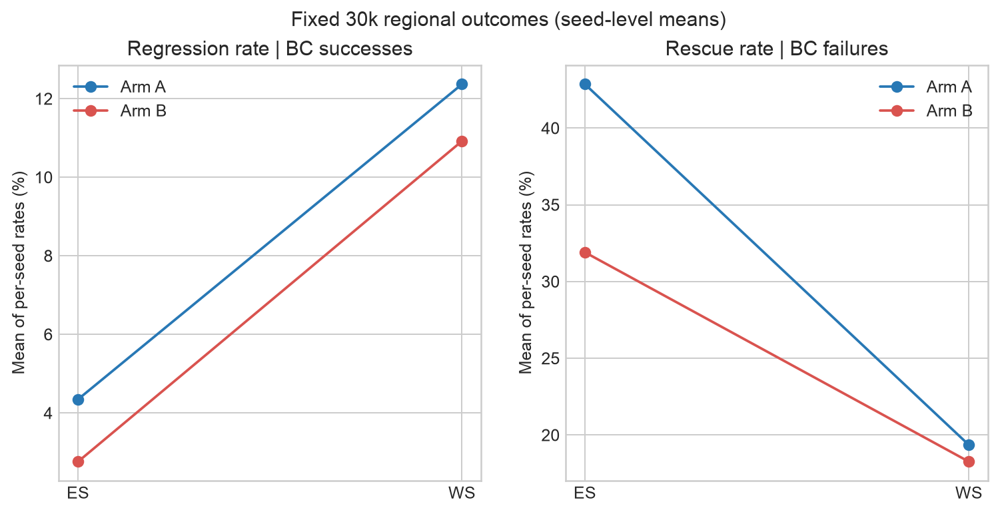
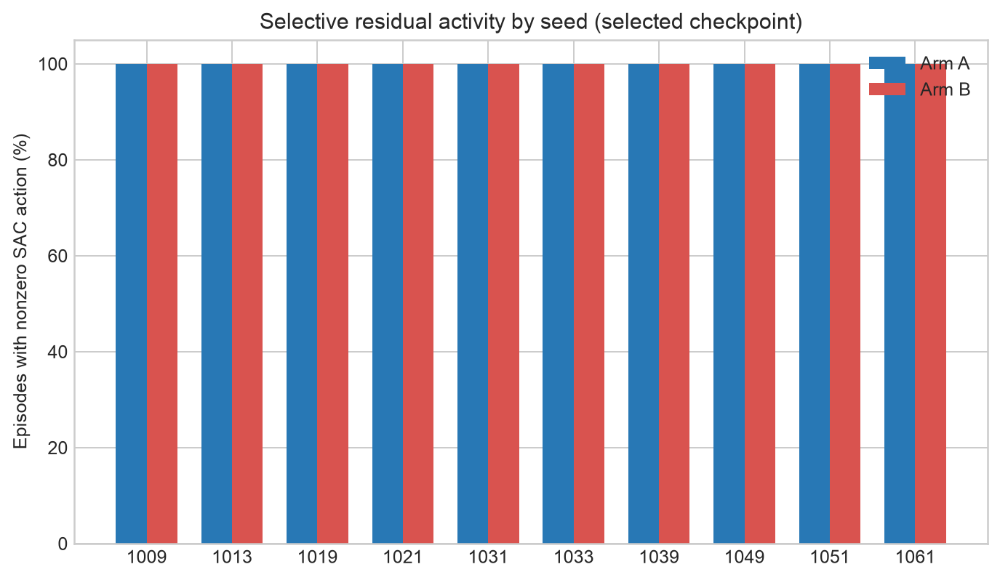
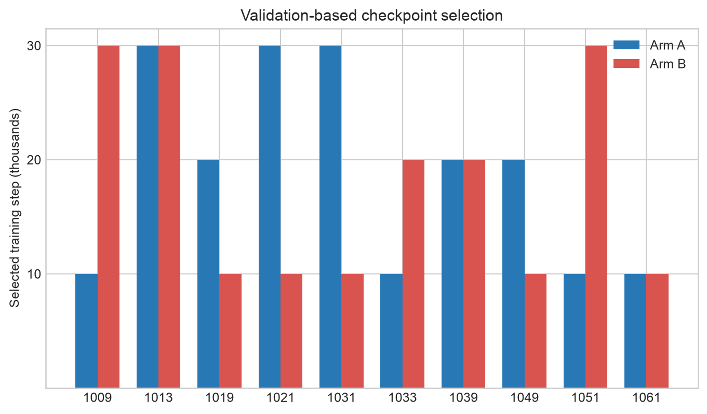

# Independent-Seed Replication of SAC Regularization Effects

## 1. Research Question and Hypotheses

This preregistered study asks whether stronger residual-action regularization (Arm B, coefficient 0.020) consistently reduces regressions relative to Arm A (0.005) across independently trained SAC seeds, and whether any regression reduction preserves rescues and overall grasp success. A second analysis evaluates per-seed checkpoints selected using a separate fixed Validation set. The primary generalization unit is the paired SAC training seed, not an individual rollout.

Expected directions were fewer regressions under B, possible rescue trade-offs, smaller differences after checkpoint selection, and regional effects in ES/WS. The protocol and SHA-256 were committed before replication training and outcome evaluation. Neither seed nor coefficient selection used the new Final outcomes.

## 2. Experimental Setup

- Ten paired independent training seeds: 1009, 1013, 1019, 1021, 1031, 1033, 1039, 1049, 1051, 1061; two arms per seed; 30,000 training steps, with 10k/20k/30k checkpoints.
- The only between-arm training condition was the residual-action penalty coefficient: A=0.005; B=0.020. Both used hard sampling, shaped reward, the same frozen BC checkpoint, 5 mm/axis residual bounds, and ±0.20 m position range.
- Validation used shared positions 250000–250499. The checkpoint rule was highest success, then fewer BC-relative regressions, shorter successful episodes, then earlier checkpoint. All 60 checkpoint hashes and validation-file hashes were frozen before Final evaluation.
- Final evaluation used the shared positions 260000–261999, 2,000 per BC baseline and per evaluated checkpoint. The primary comparison is fixed 30k; selected-checkpoint outcomes are secondary.
- Success, rescue (BC failure→SAC success), regression (BC success→SAC failure), net improvement, episode-level nonzero-residual frequency, and successful episode steps use the unchanged evaluator.

All checkpoints were evaluated on the same fixed position set within each phase. Position-level exact McNemar tests therefore describe paired differences conditional on these positions; they are not independent replications of training.

## 3. Results

### Fixed 30k (primary)

BC baseline was 1,853/2,000 (92.65%) successes on the Final positions.

| SAC seed | Arm A success | A rescue / regression / net | Arm B success | B rescue / regression / net | B−A success (pp) |
|---:|---:|---:|---:|---:|---:|
| 1009 | 1718/2000 (85.90%) | 20 / 155 / -135 | 1870/2000 (93.50%) | 46 / 29 / 17 | +7.60 |
| 1013 | 1836/2000 (91.80%) | 24 / 41 / -17 | 1898/2000 (94.90%) | 46 / 1 / 45 | +3.10 |
| 1019 | 1804/2000 (90.20%) | 22 / 71 / -49 | 1848/2000 (92.40%) | 31 / 36 / -5 | +2.20 |
| 1021 | 1869/2000 (93.45%) | 43 / 27 / 16 | 1841/2000 (92.05%) | 25 / 37 / -12 | -1.40 |
| 1031 | 1890/2000 (94.50%) | 56 / 19 / 37 | 1757/2000 (87.85%) | 10 / 106 / -96 | -6.65 |
| 1033 | 1818/2000 (90.90%) | 35 / 70 / -35 | 1734/2000 (86.70%) | 20 / 139 / -119 | -4.20 |
| 1039 | 1796/2000 (89.80%) | 12 / 69 / -57 | 1809/2000 (90.45%) | 7 / 51 / -44 | +0.65 |
| 1049 | 1734/2000 (86.70%) | 34 / 153 / -119 | 1843/2000 (92.15%) | 32 / 42 / -10 | +5.45 |
| 1051 | 1844/2000 (92.20%) | 31 / 40 / -9 | 1865/2000 (93.25%) | 42 / 30 / 12 | +1.05 |
| 1061 | 1794/2000 (89.70%) | 35 / 94 / -59 | 1817/2000 (90.85%) | 10 / 46 / -36 | +1.15 |

| Arm | Mean success | Mean rescue | Mean regression | Mean net improvement | Mean change vs BC | Episode nonzero-residual rate |
|---|---:|---:|---:|---:|---:|---:|
| A (penalty .005) | 90.52% | 31.2 | 73.9 | -42.7 | -2.14 pp | 100.0% |
| B (penalty .020) | 91.41% | 26.9 | 51.7 | -24.8 | -1.24 pp | 100.0% |

B reduced regression in 7/10 training seeds, with an average 22.2 fewer regressions per 2,000 positions. It also produced 4.3 fewer rescues on average. The higher success mean (+0.895 pp) reflects the net balance, but uncertainty across training seeds remains broad. Both fixed-30k arms still had lower mean success than BC alone (−2.14 pp for A and −1.24 pp for B); stronger regularization improved the A/B comparison, but did not make 30k SAC outperform BC on average.

### Validation-selected checkpoints (secondary)

| SAC seed | Selected step A/B (k) | Arm A success | A rescue / regression / net | Arm B success | B rescue / regression / net | B−A success (pp) |
|---:|---:|---:|---:|---:|---:|---:|
| 1009 | 10 / 30 | 1857/2000 (92.85%) | 10 / 6 / 4 | 1870/2000 (93.50%) | 46 / 29 / 17 | +0.65 |
| 1013 | 30 / 30 | 1836/2000 (91.80%) | 24 / 41 / -17 | 1898/2000 (94.90%) | 46 / 1 / 45 | +3.10 |
| 1019 | 20 / 10 | 1886/2000 (94.30%) | 53 / 20 / 33 | 1850/2000 (92.50%) | 5 / 8 / -3 | -1.80 |
| 1021 | 30 / 10 | 1869/2000 (93.45%) | 43 / 27 / 16 | 1858/2000 (92.90%) | 20 / 15 / 5 | -0.55 |
| 1031 | 30 / 10 | 1890/2000 (94.50%) | 56 / 19 / 37 | 1860/2000 (93.00%) | 9 / 2 / 7 | -1.50 |
| 1033 | 10 / 20 | 1842/2000 (92.10%) | 6 / 17 / -11 | 1835/2000 (91.75%) | 17 / 35 / -18 | -0.35 |
| 1039 | 20 / 20 | 1869/2000 (93.45%) | 27 / 11 / 16 | 1918/2000 (95.90%) | 66 / 1 / 65 | +2.45 |
| 1049 | 20 / 10 | 1871/2000 (93.55%) | 31 / 13 / 18 | 1850/2000 (92.50%) | 8 / 11 / -3 | -1.05 |
| 1051 | 10 / 30 | 1854/2000 (92.70%) | 10 / 9 / 1 | 1865/2000 (93.25%) | 42 / 30 / 12 | +0.55 |
| 1061 | 10 / 10 | 1853/2000 (92.65%) | 4 / 4 / 0 | 1855/2000 (92.75%) | 8 / 6 / 2 | +0.10 |

| Arm | Mean success | Mean rescue | Mean regression | Mean net improvement | Mean change vs BC | Mean selected step |
|---|---:|---:|---:|---:|---:|---:|
| A | 93.13% | 26.4 | 16.7 | 9.7 | +0.49 pp | 19.0k |
| B | 93.29% | 26.7 | 13.8 | 12.9 | +0.65 pp | 18.0k |

Both arms increased mean success over BC after validation selection (+0.485 pp for A; +0.645 pp for B). B had fewer regressions in 6/10 paired seeds after selection. Selection did not establish a consistent advantage for B.

Across both comparisons, the reported episode-level nonzero-residual frequency is 100% for both arms. Both are always-on SAC residual policies; this design does not reduce the number of SAC-controlled episodes. The field measures whether the evaluated episode had a nonzero residual, not computational SAC call savings.

### Region results (ES and WS)

Region sample counts are fixed by the shared positions: ES averages 311/2,000 and WS 350/2,000 per training seed. Table values below are means of per-seed counts and conditional rates; positions are not pooled as independent training observations.

| Comparison | Region | Arm | Mean rescues | Mean regressions | Rescue rate among BC failures | Regression rate among BC successes |
|---|---|---|---:|---:|---:|---:|
| fixed30k | ES | A | 9.0 | 12.6 | 42.86% | 4.34% |
| fixed30k | ES | B | 6.7 | 8.0 | 31.90% | 2.76% |
| fixed30k | WS | A | 8.9 | 37.6 | 19.35% | 12.37% |
| fixed30k | WS | B | 8.4 | 33.2 | 18.26% | 10.92% |
| selected | ES | A | 4.2 | 6.0 | 20.00% | 2.07% |
| selected | ES | B | 5.4 | 3.0 | 25.71% | 1.03% |
| selected | WS | A | 11.2 | 6.5 | 24.35% | 2.14% |
| selected | WS | B | 10.5 | 8.7 | 22.83% | 2.86% |

Fixed 30k: ES regression rates averaged 4.34% for A and 2.76% for B; WS averaged 12.37% and 10.92%. ES rescue rates were 42.86% and 31.90%; WS rescue rates were 19.35% and 18.26%. Selected checkpoints: ES regression rates were 2.07% (A) and 1.03% (B), while WS was 2.14% and 2.86%. These directional summaries vary by region and do not show uniform B improvements.

## 4. Statistical Analysis

Seed-level estimates below are paired differences B−A across ten independent training-seed pairs. Percentile confidence intervals use 10,000 paired-seed bootstrap resamples (RNG seed 20261107); exact two-sided sign tests exclude ties.

| Comparison | Effect (B−A) | Mean | 95% bootstrap CI | Exact sign p | Seeds favoring B / A / tie |
|---|---|---:|---:|---:|---:|
| fixed30k | Success rate (pp) | +0.89 | [-1.69, +3.28] | 0.3438 | 7 / 3 / 0 |
| fixed30k | Rescues / 2,000 | -4.30 | [-17.80, +8.70] | 0.7539 | 4 / 6 / 0 |
| fixed30k | Regressions / 2,000 | -22.20 | [-61.60, +18.00] | 0.3438 | 7 / 3 / 0 |
| selected | Success rate (pp) | +0.16 | [-0.72, +1.13] | 1.0000 | 5 / 5 / 0 |
| selected | Rescues / 2,000 | +0.30 | [-19.70, +19.40] | 0.7539 | 6 / 4 / 0 |
| selected | Regressions / 2,000 | -2.90 | [-14.70, +8.60] | 0.7539 | 6 / 4 / 0 |

All seed-level bootstrap intervals include zero and all seed-level exact sign tests are non-significant. The fixed-30k decision criteria were met as exploratory progression criteria: B reduced regressions in at least 7 seeds, mean success was not worse by more than 0.5 pp, and mean rescue reduction was no worse than 10. The selected-checkpoint criteria were not met because B reduced regressions in only 6/10 seeds. These criteria are not tests of statistical significance.

Exact McNemar tests compared A and B on paired Final positions within each seed, for overall success and BC-conditioned regression/rescue discordances. Holm correction was applied across seeds separately for each endpoint and comparison; ES/WS tests used a separate 40-test Holm family. Numerous individual seed-position tests remain significant after correction, reflecting large paired position counts and substantial model differences for some seeds. This does not establish generalization over training seeds.

## 5. Discussion

The fixed-30k outcome is directionally consistent with stronger regularization reducing regression for most (7/10) new SAC seeds while retaining a slightly higher mean success rate. The effect came with fewer rescues, so the result is a trade-off in how residual SAC changes BC outcomes rather than a one-sided improvement. Training-seed uncertainty is substantial and no seed-level test supports a population-level effect.

Validation checkpoint selection improved average performance over BC for both arms. It narrowed the A/B success difference and the regression reduction was less consistent (6/10), which suggests that some fixed-30k differences reflect checkpoint quality and that selection can change the apparent regularization effect.

### Exploratory regional pattern

At fixed 30k, Arm B had lower average conditional regression rates in both prespecified regions, but it also reduced the conditional rescue rate, especially in ES. After selection, B retained a lower ES regression rate but had a slightly higher WS regression rate. The registered regional seed-level bootstrap summaries and Holm-adjusted per-seed tests are retained in the CSV/JSON outputs; no direction should be read as universal.

## 6. Limitations

- Ten independent training seeds provide limited precision for training-population effects; the bootstrap and sign test are correspondingly coarse.
- All models share the same fixed 2,000 Final positions. Paired McNemar tests condition on this benchmark and cannot substitute for new independent training seeds.
- Validation-based checkpoint selection is itself adaptive. A separate Final set protects the reported selected-checkpoint results, but the selected arm comparison is secondary.
- The setup evaluates always-on SAC residual control; it cannot substantiate reduced SAC compute or intervention use.
- Only the residual penalty coefficient differs by design; findings do not automatically generalize to different BC policies, environments, reward definitions, residual bounds, or sampling regimes.
- The pre-registered spatial regions are coarse; within-region failure mechanisms are not isolated.
- Direct TD error and Q1/Q2 disagreement were not logged and are not inferred from critic loss.

## 7. Next Research Direction

Replicate the penalty comparison with a larger preregistered set of independent SAC training seeds, then test a separately specified adaptive gate that can abstain from SAC residual calls. Keep its calibration set separate from validation and final evaluation, retain the same paired-position design, and track actual SAC invocations and wall-clock cost alongside rescue/regression outcomes. A follow-up should investigate the ES/WS interaction with a confirmatory spatial design rather than tune the penalty from these exploratory regional means.

## Reproducibility Artifacts

- Preregistration: [`bc_results/sac_regularization_replication_protocol.json`](bc_results/sac_regularization_replication_protocol.json) (SHA-256 `4f72e2b172c197a64f4f3377f70021b4222f87e63622cdde02ff4a704ed7739d`).
- Frozen checkpoint selection and model hashes: [`bc_results/sac_regularization_replication_checkpoint_freeze.json`](bc_results/sac_regularization_replication_checkpoint_freeze.json).
- Selection metrics: [`bc_results/sac_regularization_replication_validation_metrics.csv`](bc_results/sac_regularization_replication_validation_metrics.csv).
- Per-seed and regional metrics, paired tests, bootstrap summaries, training diagnostics, and full machine-readable summary are under `bc_results/sac_regularization_replication_*.csv` and [`bc_results/sac_regularization_replication_final_summary.json`](bc_results/sac_regularization_replication_final_summary.json).
- Evaluation runner: [`run_sac_regularization_replication_evaluations.py`](run_sac_regularization_replication_evaluations.py); analysis runner: [`analyze_sac_regularization_replication.py`](analyze_sac_regularization_replication.py).
- Figures are saved in `bc_results/sac_regularization_replication_figures/` in PNG and SVG formats.

### Fixed-30k success by SAC seed

### Fixed-30k rescue and regression effects

### Selected-checkpoint success

### ES/WS regional outcomes

### Episode nonzero residual frequency

### Validation-selected steps

