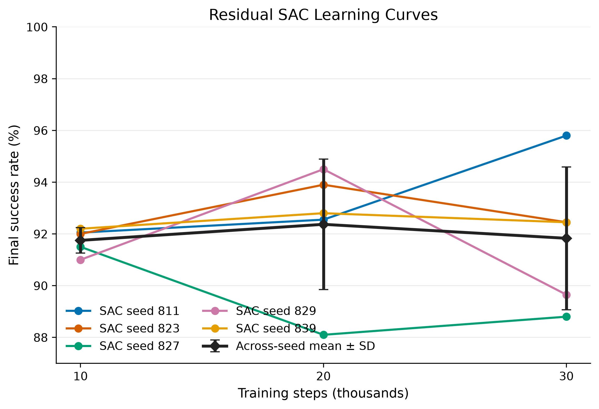
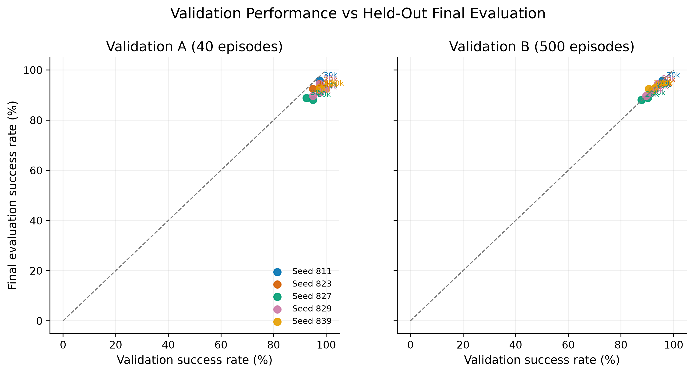
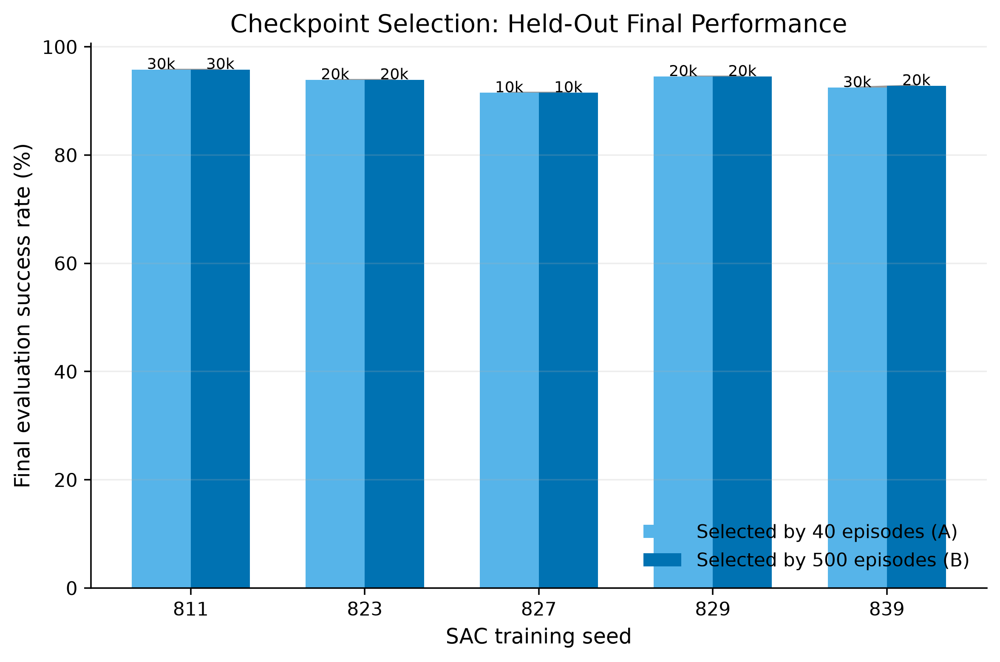
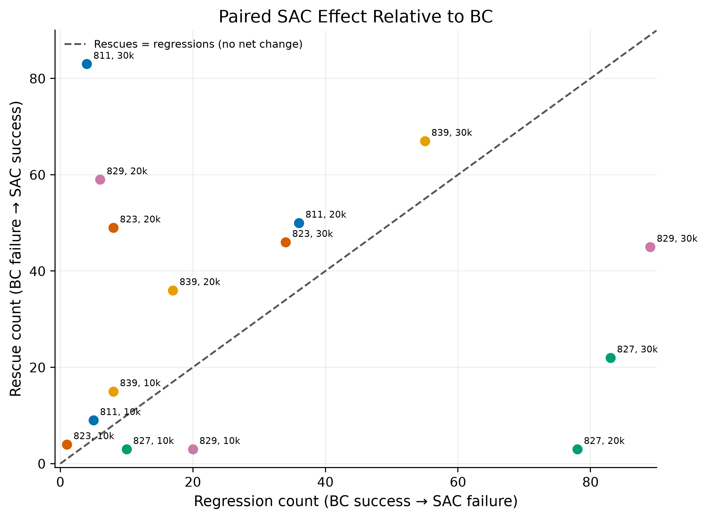

# SAC Training Stability Analysis

## 1. Research Question

Why does residual SAC performance vary across training seeds, and how reliably can validation-based checkpoint selection identify a policy that improves Behavior Cloning (BC)? This study tests whether learning trajectories differ by seed and step, whether a 40-episode validation set is too coarse for checkpoint selection, and whether a 500-episode set selects checkpoints with better held-out performance.

## 2. Hypotheses

- **H1:** SAC performance depends on both training seed and training step; more training does not guarantee improvement.
- **H2:** A 40-episode validation set can fail to resolve small differences between checkpoints.
- **H3:** Selection with 500 validation episodes may yield more reliable final performance than selection with 40 episodes.

All five new SAC seeds (811, 823, 827, 829, 839) were fixed before any final-evaluation outcome was inspected. The checkpoint choices were frozen in `bc_results/sac_stability_selection_freeze.json` before the 2,000-position final evaluation.

## 3. Existing Checkpoint Audit

The five existing Condition C runs were `C_hard_shaped_seed{7,19,73,202,314}`. For each, `best_model.zip`, `final_model.zip`, `config.json`, and `eval_history.csv` were present. SHA-256 hashes and file sizes for both saved model files, along with the configuration and complete history, are recorded in `bc_results/sac_stability_checkpoint_audit.json`. No existing run was retrained or modified.

Validation A history and the callback-selected Best timestep:

| SAC seed | 10k (successes/40) | 20k | 30k | Best timestep |
|---:|---:|---:|---:|---:|
| 7 | 39 (97.5%) | 38 (95.0%) | 38 (95.0%) | 10k |
| 19 | 39 (97.5%) | 38 (95.0%) | 36 (90.0%) | 10k |
| 73 | 39 (97.5%) | 38 (95.0%) | 34 (85.0%) | 10k |
| 202 | 39 (97.5%) | 39 (97.5%) | 37 (92.5%) | 10k; tied success rate resolved by successful-step mean |
| 314 | 39 (97.5%) | 38 (95.0%) | 39 (97.5%) | 30k; tied success rate resolved by successful-step mean |

The old training code retained Best and Final weights, but not a complete trajectory of weights at 10k/20k/30k. The history is evidence of validation metrics only; it cannot reconstruct the missing checkpoints. Therefore, old models are evaluated only as saved Best and Final checkpoints. Seed 314's 30k Best does not establish that training to 30k caused its strong performance: 10k also scored 39/40, and the callback selected 30k via its shorter successful-episode tie-break.

## 4. Experimental Setup

All runs used Condition C with the fixed BC checkpoint `bc_models/fair_wide_expert_seed42.pt`, frozen BC weights, SAC, ±20 cm uniform evaluation positions, ±5 mm per-axis residual, 90% hard-sampled training positions outside the ±12 cm demonstration square, shaped reward, deterministic evaluation, and the existing MuJoCo environment, success criterion, episode limit, and SAC hyperparameters. New runs used 30,000 training steps and saved separate 10k, 20k, and 30k snapshots.

Validation A used episode seeds 61000–61039. Validation B used the disjoint seeds 210000–210499 (500 episodes). Final evaluation used the disjoint, previously unused seeds 220000–221999 (2,000 episodes). Prior final ranges 150000–151999, 170000–171999, and 190000–191999 were excluded.

The final BC-only trajectory was evaluated once and reused for the 15 new snapshots and 10 old checkpoints. Each SAC checkpoint was run on all 2,000 positions using the same `run_episode` evaluator and paired seeds. The analysis verified identical initial coordinates and BC success outcomes across all paired files. The shared baseline had 1,837/2,000 successes (91.85%).

The run used Python 3.12.10, arm64, NumPy 2.5.4, Gymnasium 1.4.0, MuJoCo 3.17.0, Stable-Baselines3 2.9.2, PyTorch 2.15.0, CPU. Individual rollout results were flushed to a resumable partial CSV during long runs; completed CSVs contain the full requested episode ranges.

## 5. Training Progress

| New SAC seed | Final 10k | Final 20k | Final 30k | Observed trajectory |
|---:|---:|---:|---:|---|
| 811 | 92.05% | 92.55% | 95.80% | Continued improvement |
| 823 | 92.00% | 93.90% | 92.45% | Peaked at 20k, declined at 30k |
| 827 | 91.50% | 88.10% | 88.80% | Fell sharply by 20k, slight recovery |
| 829 | 91.00% | 94.50% | 89.65% | Peaked at 20k, declined at 30k |
| 839 | 92.20% | 92.80% | 92.45% | Little change (0.60 pp range) |

Only seed 811 improved continuously. Seeds 823 and 829 peaked at 20k; seed 827 deteriorated after 10k; seed 839 changed little. Thus, on the held-out positions, continued training did not reliably improve performance.

## 6. Checkpoint Selection Methods

Selection A chose the highest Validation A success rate among 10k/20k/30k; ties used the existing callback's mean successful-episode steps, with chronological order retained for any remaining tie. Selection B used the same rule on the 500 Validation B episodes. Both choices were frozen and hashed before final evaluation. No final result was used for selection.

| SAC seed | Selection A (40 episodes) | Selection B (500 episodes) | Same checkpoint? | Final A | Final B |
|---:|---:|---:|:---:|---:|---:|
| 811 | 30k | 30k | Yes | 95.80% | 95.80% |
| 823 | 20k | 20k | Yes | 93.90% | 93.90% |
| 827 | 10k | 10k | Yes | 91.50% | 91.50% |
| 829 | 20k | 20k | Yes | 94.50% | 94.50% |
| 839 | 30k | 20k | No | 92.45% | 92.80% |

The two rules agreed for four of five models. Their mean final rates were 93.63% (A) and 93.70% (B). B was higher for one model and tied for four; A was higher for none. The 0.07 pp mean difference is descriptive and is not statistically supported. For seed 839, Validation A preferred 30k (40/40), while B preferred 20k (465/500 vs 453/500 at 30k); final rates favored B by 0.35 pp, but the paired comparison was not significant after Holm correction.

Validation A's 40/40 result for seed 839 illustrates its coarse resolution: one episode changes the rate by 2.5 percentage points. Validation B resolves outcomes more finely (0.2 pp per episode) and aligned more closely with final performance across checkpoint observations (descriptive Spearman ρ=0.914 for B vs 0.545 for A). These 15 observations are nested within five models and share positions, so these correlations are descriptive, not independent-sample inference. The extra Validation B workload was 500 paired BC/SAC position evaluations per candidate (1,000 policy rollouts), versus 40 paired positions per candidate for Validation A: 12.5 times as many positions.

## 7. Results

The table reports all 15 new checkpoints. Rescue is BC failure → SAC success; regression is BC success → SAC failure. Positive net improvement means rescues exceed regressions. The paired BC baseline is 1,837/2,000 (91.85%).

| SAC seed | Steps | Val A /40 | Val B /500 | Final /2000 | Rescue | Regression | Net | Δ vs BC (pp) |
|---:|---:|---:|---:|---:|---:|---:|---:|---:|
| 811 | 10k | 39 (97.5%) | 462 (92.4%) | 1841 (92.05%) | 9 | 5 | +4 | +0.20 |
| 811 | 20k | 39 (97.5%) | 463 (92.6%) | 1851 (92.55%) | 50 | 36 | +14 | +0.70 |
| 811 | 30k | 39 (97.5%) | 479 (95.8%) | 1916 (95.80%) | 83 | 4 | +79 | +3.95 |
| 823 | 10k | 39 (97.5%) | 460 (92.0%) | 1840 (92.00%) | 4 | 1 | +3 | +0.15 |
| 823 | 20k | 39 (97.5%) | 470 (94.0%) | 1878 (93.90%) | 49 | 8 | +41 | +2.05 |
| 823 | 30k | 38 (95.0%) | 464 (92.8%) | 1849 (92.45%) | 46 | 34 | +12 | +0.60 |
| 827 | 10k | 39 (97.5%) | 459 (91.8%) | 1830 (91.50%) | 3 | 10 | −7 | −0.35 |
| 827 | 20k | 38 (95.0%) | 439 (87.8%) | 1762 (88.10%) | 3 | 78 | −75 | −3.75 |
| 827 | 30k | 37 (92.5%) | 451 (90.2%) | 1776 (88.80%) | 22 | 83 | −61 | −3.05 |
| 829 | 10k | 39 (97.5%) | 458 (91.6%) | 1820 (91.00%) | 3 | 20 | −17 | −0.85 |
| 829 | 20k | 39 (97.5%) | 470 (94.0%) | 1890 (94.50%) | 59 | 6 | +53 | +2.65 |
| 829 | 30k | 38 (95.0%) | 448 (89.6%) | 1793 (89.65%) | 45 | 89 | −44 | −2.20 |
| 839 | 10k | 39 (97.5%) | 464 (92.8%) | 1844 (92.20%) | 15 | 8 | +7 | +0.35 |
| 839 | 20k | 39 (97.5%) | 465 (93.0%) | 1856 (92.80%) | 36 | 17 | +19 | +0.95 |
| 839 | 30k | 40 (100%) | 453 (90.6%) | 1849 (92.45%) | 67 | 55 | +12 | +0.60 |

Across the five training seeds, final rates were:

| Steps | Mean success rate | Sample SD | Range |
|---:|---:|---:|---:|
| 10k | 91.75% | 0.49 pp | 91.00–92.20% (1.20 pp) |
| 20k | 92.37% | 2.52 pp | 88.10–94.50% (6.40 pp) |
| 30k | 91.83% | 2.76 pp | 88.80–95.80% (7.00 pp) |

At 10k, the seeds were tightly clustered; seed-related spread was much larger at 20k and 30k. Mean within-seed 10k-to-30k range was 2.90 pp; mean cross-seed range across steps was 4.87 pp. These are descriptive comparisons of repeated models on shared positions, not independent observations.

The old saved checkpoints were evaluated on the same new final positions:

| Old SAC seed | Checkpoint | Final | Rescue | Regression | Net | Δ vs BC (pp) |
|---:|---|---:|---:|---:|---:|---:|
| 7 | Best | 1841/2000 (92.05%) | 10 | 6 | +4 | +0.20 |
| 7 | Final | 1838/2000 (91.90%) | 51 | 50 | +1 | +0.05 |
| 19 | Best | 1843/2000 (92.15%) | 8 | 2 | +6 | +0.30 |
| 19 | Final | 1769/2000 (88.45%) | 2 | 70 | −68 | −3.40 |
| 73 | Best | 1829/2000 (91.45%) | 8 | 16 | −8 | −0.40 |
| 73 | Final | 1632/2000 (81.60%) | 23 | 228 | −205 | −10.25 |
| 202 | Best | 1847/2000 (92.35%) | 12 | 2 | +10 | +0.50 |
| 202 | Final | 1789/2000 (89.45%) | 19 | 67 | −48 | −2.40 |
| 314 | Best | 1930/2000 (96.50%) | 94 | 1 | +93 | +4.65 |
| 314 | Final | 1931/2000 (96.55%) | 95 | 1 | +94 | +4.70 |

Seed 314's strong performance reproduced on the new positions for both saved Best and Final models. This is a result for the checkpoints as saved; the earlier history does not show that extra training to 30k alone caused the result.









## 8. Statistical Analysis

Exact two-sided McNemar tests use paired discordant episode outcomes. For each checkpoint step, Holm correction was applied separately across the five SAC training seeds; Selection A vs B is a fourth prespecified family, also Holm-corrected across five seeds. Tests are conditional on the five frozen models and the shared final positions; they do not treat model-by-position rows as independent training-seed samples.

Among the 15 per-seed checkpoint-vs-BC tests, corrected evidence was mixed rather than consistent:

- At 10k, seed 829 was worse than BC after correction (20 regressions vs 3 rescues; Holm p=0.00244). The other four seeds were not significant after correction.
- At 20k, seed 823 was better (49 vs 8, p=8.15×10⁻⁸), seed 827 was worse (3 vs 78, p=3.67×10⁻¹⁹), seed 829 was better (59 vs 6, p=1.99×10⁻¹¹), and seed 839 was better (36 vs 17, p=0.0253). Seed 811 was not significant.
- At 30k, seed 811 was better (83 vs 4, p=1.51×10⁻¹⁹); seeds 827 (22 vs 83, p=6.47×10⁻⁹) and 829 (45 vs 89, p=0.000540) were worse. Seeds 823 and 839 were not significant after correction.
- For Selection A vs B, only seed 839 selected different steps. Its paired difference (67 B wins vs 60 losses) was not significant (Holm p=1.0). The other four choices were identical, so their paired tests have no discordances.

These per-seed paired tests are not evidence that SAC generally improves or degrades across the population of training seeds. There are only five independent training runs, and the same final positions are shared. The study supports heterogeneous checkpoint effects conditional on these runs, not a universal mean effect.

## 9. Cross-Seed Variability

The largest cross-seed ranges occurred at later steps: 6.40 pp at 20k and 7.00 pp at 30k, versus 1.20 pp at 10k. At 20k, seed 827 was 5.80 pp below the shared BC baseline while seed 829 was 2.65 pp above it. At 30k, seed 811 was 3.95 pp above BC, whereas seed 827 was 3.05 pp below and seed 829 was 2.20 pp below. Learning duration alone does not explain these differences.

Validation B had stronger descriptive alignment with final checkpoint rates than Validation A in this sample. Selection B nevertheless changed the selected step for only one seed and did not significantly outperform Selection A. Five seeds are too few to establish stable selection superiority or estimate a reliable training-seed population distribution.

## 10. Discussion

H1 is supported descriptively: checkpoint performance varied by both training seed and step, and only one of five new seeds improved monotonically through 30k. H2 is plausible and illustrated by seed 839, for which a 40/40 result selected a different checkpoint from the 500-episode set; the coarseness is structural because a single A episode changes the rate by 2.5 pp. H3 is not established: B's mean selected result was only 0.07 pp higher, with four ties and one small win, and the paired comparison was not significant.

Rescue/regression counts show why overall success rate alone is insufficient. Seed 811 at 30k had 83 rescues and only 4 regressions, while seed 827 at 20k had 3 rescues and 78 regressions. Seed 829 changed from net +53 at 20k to net −44 at 30k. Thus the residual policy can help many BC failures in one run while damaging BC successes in another.

**Observed facts:** performance diverged after 10k, checkpoint-level rescue/regression balance varied substantially, and old Seed 314 Best and Final both performed strongly on the fresh final set. **Possible explanations, not tested causally here:** stochastic exploration, replay-buffer composition, critic approximation error, entropy-temperature dynamics, and interactions between hard sampling and shaped reward may create seed-sensitive learning trajectories. The experiment does not identify which mechanism caused any observed result.

The evidence favors improving and diagnosing SAC policy quality before making Adaptive Gate Learning the main next step. A gate can limit the use of residual actions, but cannot reliably turn a highly regressive residual policy into a dependable correction. Adaptive gating can continue as a contained follow-up once SAC policies show reproducible positive paired gains across more training seeds and validation selections retain those gains on a fresh test set.

## 11. Limitations

- Only five new SAC training seeds were tested; cross-seed estimates and selection comparisons are uncertain.
- Validation A, Validation B, and final positions are shared across models. Position-level results across checkpoints/models are correlated and were not pooled as independent observations.
- McNemar tests condition on fixed policies and evaluation positions. They do not capture variability from retraining a SAC seed.
- Validation B selection is still model selection on a finite sample and can incur selection bias. The final set remained disjoint and unopened during selection.
- Validation A has only 40 episodes and a 2.5 pp success-rate increment. Validation B costs 12.5 times more candidate positions.
- Existing seeds 7, 19, 73, 202, and 314 lack saved 10k/20k trajectory weights. Their log histories cannot substitute for missing model files.
- The shared final BC baseline avoids redundant BC computation. Each SAC checkpoint was still separately evaluated on all 2,000 positions, paired to that same baseline.
- The reported mechanistic causes of instability are hypotheses; no replay, critic, or entropy diagnostics were manipulated to test causality.

## 12. Next Research Direction

First run a larger, preregistered Condition C replication with additional training seeds and retain per-step checkpoints plus replay/critic/entropy diagnostics. Select a checkpoint using a frozen validation rule and verify it on a second untouched test-position set. Prioritize criteria that require positive rescue-minus-regression and no meaningful degradation of BC successes, not success rate alone. Advance Adaptive Gate Learning as a main study once these SAC gains are repeatable across seeds and held-out positions; then compare fixed and adaptive gates without reusing calibration positions as final test data.

## 13. Reproduction Instructions

From the repository root with the project virtual environment and MuJoCo assets installed:

```bash
MPLCONFIGDIR=/private/tmp/mplcache .venv/bin/python -m unittest \
  test_selective_residual_gate.py test_policy_specific_gate.py test_sac_stability.py
MPLCONFIGDIR=/private/tmp/mplcache .venv/bin/python run_sac_stability_training.py
MPLCONFIGDIR=/private/tmp/mplcache .venv/bin/python run_sac_stability_evaluations.py validation-b
MPLCONFIGDIR=/private/tmp/mplcache .venv/bin/python freeze_sac_checkpoint_selection.py
MPLCONFIGDIR=/private/tmp/mplcache .venv/bin/python run_sac_stability_evaluations.py final
MPLCONFIGDIR=/private/tmp/mplcache .venv/bin/python analyze_sac_stability.py
MPLBACKEND=Agg MPLCONFIGDIR=/private/tmp/mplcache \
  .venv/bin/python plot_sac_stability.py
```

Training/evaluation scripts preserve complete prior outputs and reject incomplete or differing existing files rather than overwriting them. Model binaries remain local and are excluded from version control. CSV/JSON metrics, the frozen selection manifest, source, figures, and this report are the shareable experiment record.
